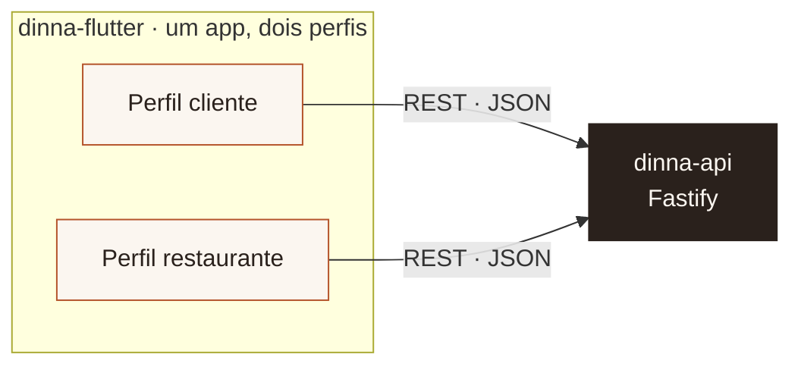
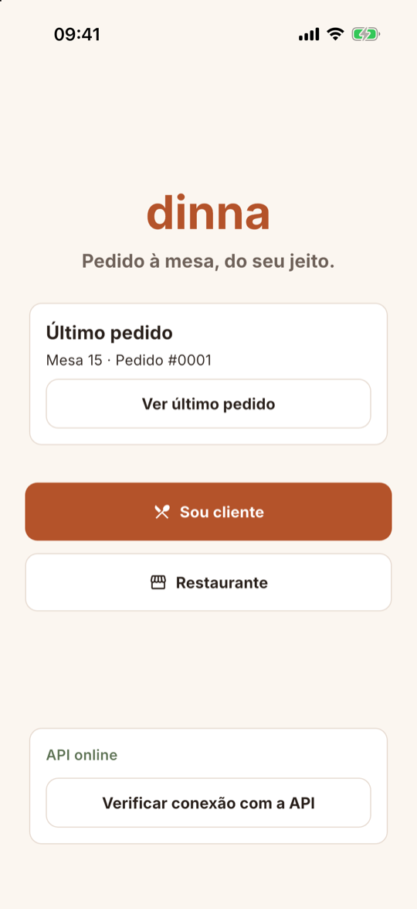
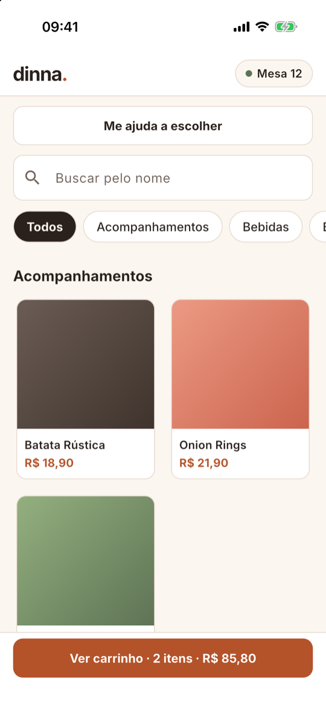
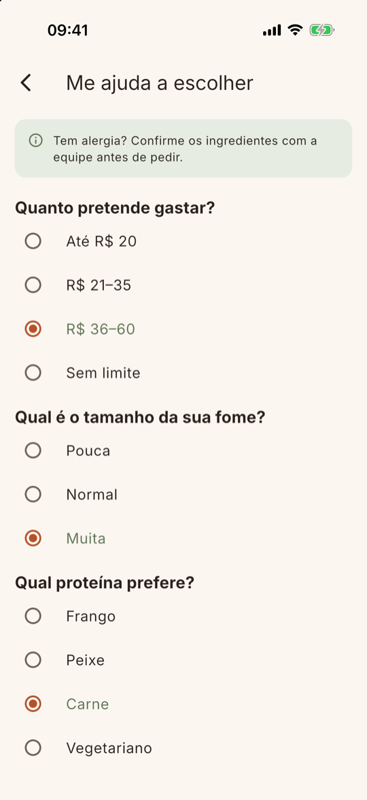
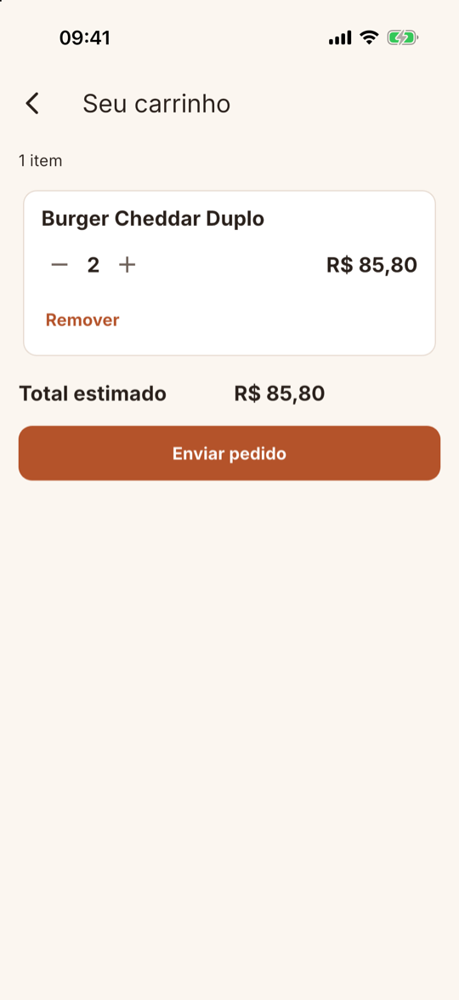
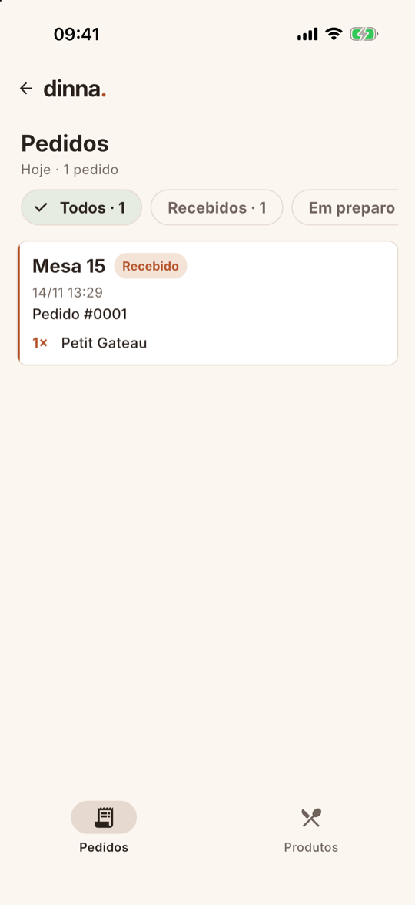
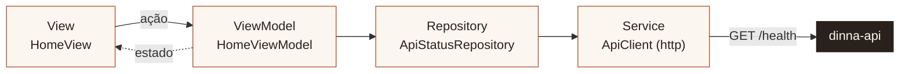

<a id="topo"></a>

<p align="center">
  <picture>
    <source media="(prefers-reduced-motion: reduce)" srcset="docs/assets/readme/hero-still.svg" />
    
  </picture>
</p>

<h1 align="center">dinna-flutter</h1>

<p align="center">
  <strong>Pedido à mesa, do seu jeito.</strong><br />
  O aplicativo Flutter do Dinna: a experiência do cliente e a operação do restaurante em um único app.
</p>

<p align="center">
  <a href="#comece-aqui"><strong>COMEÇAR →</strong></a>
  &nbsp;·&nbsp;
  <a href="#conheca-o-dinna">CONHEÇA O DINNA</a>
  &nbsp;·&nbsp;
  <a href="#arquitetura">ARQUITETURA</a>
  &nbsp;·&nbsp;
  <a href="#estado-atual">FUNCIONALIDADES</a>
  &nbsp;·&nbsp;
  <a href="#roadmap">ROADMAP</a>
  &nbsp;·&nbsp;
  <a href="CONTRIBUTING.md">CONTRIBUIR</a>
  &nbsp;·&nbsp;
  <a href="https://github.com/jeancarlosaps/dinna-api">BACKEND REST DO DINNA</a>
</p>

<p align="center">
  <a href="https://github.com/jeancarlosaps/dinna-flutter/actions/workflows/ci.yml"></a>
  
  
  
  
</p>

---

## Ecossistema Dinna

O Dinna é formado por dois repositórios que trabalham juntos:

| Repositório | Papel | Stack |
|---|---|---|
| **dinna-flutter** (este) | App único com dois perfis: **cliente** (mesa, cardápio, carrinho, pedido) e **restaurante** (fila, status, cardápio) | Flutter · Dart · Material 3 |
| [**dinna-api**](https://github.com/jeancarlosaps/dinna-api) | Backend REST do Dinna: produtos, pedidos, status e recomendação de pratos | Node.js · TypeScript · Fastify |



O app consome todos os endpoints do [contrato REST](https://github.com/jeancarlosaps/dinna-api/blob/main/docs/api-contract.md). A relação completa está em [Integração com o backend](#integracao-backend).

<a id="conheca-o-dinna"></a>

## Conheça o Dinna

Capturas reais do app no iOS Simulator, conectado à API local com o cardápio de demonstração. Mesas, pedidos e produtos são dados de teste.

<table>
  <tr>
    <td align="center" width="33%">
      <br />
      <sub><strong>Tela inicial</strong><br />Entradas do cliente e do restaurante</sub>
    </td>
    <td align="center" width="33%">
      <br />
      <sub><strong>Cardápio</strong><br />Categorias, busca e carrinho</sub>
    </td>
    <td align="center" width="33%">
      <br />
      <sub><strong>“Me ajuda a escolher”</strong><br />Preferências do cliente</sub>
    </td>
  </tr>
  <tr>
    <td align="center" width="33%">
      <br />
      <sub><strong>Sugestões de pratos</strong><br />Escolha pelo Gemini</sub>
    </td>
    <td align="center" width="33%">
      <br />
      <sub><strong>Carrinho</strong><br />Quantidade, total e envio</sub>
    </td>
    <td align="center" width="33%">
      <br />
      <sub><strong>Painel do restaurante</strong><br />Fila de pedidos e produtos</sub>
    </td>
  </tr>
</table>

> A tela de sugestões mostra uma escolha real do Gemini (`provider: "answered"`), sempre limitada aos pratos elegíveis do cardápio. A chave é opcional: sem `GEMINI_API_KEY`, com timeout ou falha do provedor, a API escolhe os pratos por regras determinísticas e o app avisa que “A Dinna não respondeu agora”. Nesse caso a lista **não** é gerada por IA.

---

## 01 · O produto

O Dinna é um app de pedidos feitos **dentro do restaurante**. **Não é delivery.**

Em restaurantes, pizzarias e bares com atendimento à mesa, boa parte do pedido depende de um atendente estar livre: para trazer o cardápio, tirar dúvidas, anotar o pedido e contar em que etapa ele está. No horário de pico, o tempo entre *“já sei o que quero”* e *“a cozinha recebeu meu pedido”* passa a depender mais da equipe do que do cliente.

O Dinna encurta esse intervalo **sem substituir o atendimento humano**:

- o cliente identifica a mesa, explora o cardápio, monta o carrinho, envia o pedido e acompanha o status;
- o restaurante recebe os pedidos em fila, atualiza o preparo e mantém o cardápio em dia;
- o recurso **“Me ajuda a escolher”** sugere pratos com base nas preferências do cliente e no cardápio real.

> As personas Marina (cliente) e Ricardo (restaurante) orientam o produto. As hipóteses ainda não foram validadas com usuários reais.

<a id="estado-atual"></a>

## 02 · Funcionalidades

Legenda: ✅ implementado e coberto por testes automatizados · ⬜ planejado.

| Funcionalidade | Situação | Onde |
|---|---|---|
| Tela inicial | ✅ Entradas **Sou cliente** e **Restaurante**, último pedido salvo no aparelho e verificação de `GET /health` | [`lib/features/home/`](lib/features/home/) |
| Mesa | ✅ Número da mesa digitado, de 1 a 999 | [`lib/features/client/table/`](lib/features/client/table/) |
| Cardápio | ✅ Produtos por categoria, filtro, busca pelo nome sem diferenciar maiúsculas nem acentos e selo “Esgotado” | [`lib/features/menu/`](lib/features/menu/) |
| Detalhe do produto | ✅ Bottom sheet com descrição, ingredientes e quantidade de 1 a 99 | [`lib/features/menu/`](lib/features/menu/) |
| Carrinho | ✅ Quantidade, remoção e total estimado, persistidos no aparelho | [`lib/features/client/cart/`](lib/features/client/cart/) |
| Envio do pedido | ✅ Envio idempotente (`Idempotency-Key`), nova tentativa em caso de erro e confirmação com número público | [`lib/features/client/order/`](lib/features/client/order/) |
| Acompanhamento do pedido | ✅ Status atualizado a cada 5 s enquanto a tela está visível | [`lib/features/client/order/`](lib/features/client/order/) |
| “Me ajuda a escolher” | ✅ Formulário, sugestões do cardápio, adicionar ao carrinho, pedir outra sugestão e preferências salvas | [`lib/features/recommendation/`](lib/features/recommendation/) |
| Sugestão pelo Gemini | ✅ Validada com o provedor real pelo endpoint e pelo app. Opcional: depende de `GEMINI_API_KEY` no backend; sem chave, com timeout ou falha do provedor, a API usa o fallback determinístico | [dinna-api](https://github.com/jeancarlosaps/dinna-api/blob/main/README.md#recomenda%C3%A7%C3%A3o-de-pratos) |
| Fila do restaurante | ✅ Pedidos por status, atualização a cada 10 s, detalhe e avanço Recebido → Preparando → Pronto → Finalizado | [`lib/features/restaurant/`](lib/features/restaurant/) |
| Cardápio do restaurante | ✅ Cadastro, edição e desativação de produtos | [`lib/features/restaurant/`](lib/features/restaurant/) |
| Token de acesso à API | ✅ Header `X-Dinna-Api-Token` opcional, definido na compilação | [`lib/core/config/`](lib/core/config/) |
| Leitura da mesa por QR Code | ⬜ Planejado (R3) | — |
| Login de usuário | ⬜ Fora do escopo do MVP | — |

---

## 03 · Jornada do produto

<p align="center">
  
</p>

**Cliente (Marina)**

| Etapa | O que faz |
|---|---|
| Mesa | Informa o número da mesa |
| Cardápio | Navega por categorias, busca e vê produtos indisponíveis |
| Produto | Vê descrição, ingredientes e preço; escolhe a quantidade |
| “Me ajuda a escolher” | Responde perguntas rápidas e recebe sugestões do cardápio |
| Carrinho | Altera quantidade, remove itens e confere o total |
| Pedido | Envia o pedido da mesa e recebe a confirmação |
| Acompanhamento | Segue o status: Recebido → Preparando → Pronto → Finalizado |

**Restaurante (Ricardo)**

| Etapa | O que faz |
|---|---|
| Fila | Recebe os pedidos das mesas e filtra por status |
| Detalhes | Vê itens, quantidades e observações |
| Preparo | Avança o status do pedido até finalizado |
| Cardápio | Cria, edita e desativa produtos |

---

## 04 · Stack

| Camada | Escolha | Por quê |
|---|---|---|
| UI | Flutter 3.47.7 (stable), Material 3 | Um código para Android e iOS; Material 3 com tema próprio |
| Linguagem | Dart 3.13.5, null safety | Padrão do Flutter stable |
| Estado | `ChangeNotifier` + `ListenableBuilder` | Nativos do Flutter e suficientes para MVVM; sem dependência extra |
| HTTP | [`http`](https://pub.dev/packages/http) 1.6.0 | Pacote oficial do time Dart, testável com `MockClient` |
| Persistência local | `sqflite` 2.4.5 + arquivos via `path_provider` | Carrinho e último pedido em SQLite; intenção de pedido e preferências em arquivo |
| Navegação | `onGenerateRoute` nativo | `Navigator` do Flutter, sem pacote extra. O mapa está em [`docs/ARCHITECTURE.md`](docs/ARCHITECTURE.md) |
| Lint | `flutter_lints` 6.0.0 + regras em `analysis_options.yaml` | Análise estrita (`strict-casts`, `strict-raw-types`) |

Dependências diretas: `http`, `sqflite`, `path`, `path_provider` e `cupertino_icons`. Nenhuma biblioteca de estado ou injeção de dependência foi adicionada.

<a id="arquitetura"></a>

## 05 · Arquitetura MVVM



| Camada | Responsabilidade | Não pode |
|---|---|---|
| **View** | Desenhar o estado e repassar ações do usuário | Ter regra de negócio ou chamar HTTP |
| **ViewModel** | Guardar loading, success e error e orquestrar a ação | Conhecer widget, `http` ou `ApiException` |
| **Repository** | Entregar dados ao ViewModel e traduzir payload e falhas do Service | Conhecer UI ou estado visual |
| **Service (`ApiClient`)** | HTTP, serialização, timeout e status code; falhas viram `ApiException` | Conhecer regra de negócio ou estado de tela |

O contrato completo, as dependências permitidas, o passo a passo do fluxo de referência (`GET /health`) e como criar uma feature estão em [`docs/ARCHITECTURE.md`](docs/ARCHITECTURE.md).

Regras que o código segue:

- As dependências são montadas em [`lib/main.dart`](lib/main.dart) e passadas por construtor. Não há service locator.
- O ViewModel nasce no `State` da tela (`createViewModel`) e é descartado no `dispose`. Depois do `dispose`, não altera estado nem notifica.
- O Repository traduz `ApiException` em resultados do domínio. O ViewModel não conhece detalhes de HTTP.
- O `ApiClient` lê o formato de erro da API (`{ "error": { "code", "message" } }`) e converte falhas de rede, timeout, HTTP e corpo que não é JSON em `ApiException`.

### Estrutura

```text
lib/
├── main.dart                         # composição: AppConfig, ApiClient, repositories
├── app/
│   ├── app.dart                      # MaterialApp + tema + rotas
│   ├── router/                       # nomes de rota e onGenerateRoute
│   └── theme/                        # paleta, layout e ThemeData Material 3
├── core/
│   ├── config/app_config.dart        # API_BASE_URL e API_TOKEN por ambiente
│   ├── domain/                       # models compartilhados
│   ├── network/                      # ApiClient (Service HTTP) e ApiException
│   └── storage/dinna_database.dart   # banco SQLite local versionado
├── features/
│   ├── home/                         # entradas do app e GET /health
│   ├── client/
│   │   ├── table/                    # mesa
│   │   ├── cart/                     # carrinho e sessão persistida
│   │   └── order/                    # envio, confirmação e acompanhamento
│   ├── menu/                         # cardápio e detalhe do produto
│   ├── recommendation/               # "Me ajuda a escolher"
│   └── restaurant/                   # fila, detalhe do pedido e cardápio do restaurante
└── shared/
    └── widgets/                      # DinnaLogo, DinnaBanner, DinnaEmptyState
test/                                 # espelha lib/
docs/ARCHITECTURE.md                  # contrato das camadas MVVM
docs/assets/readme/                   # ilustrações deste README
docs/assets/screenshots/              # capturas do app
```

Cada feature segue a mesma divisão em View, ViewModel e Repository. O detalhe do produto abre como bottom sheet sobre o cardápio; a rota `/product` existe no mapa, mas ainda mostra uma página provisória (`RoutePlaceholder`).

<a id="comece-aqui"></a>

## 06 · Comece aqui

### Requisitos

| Para | Precisa de |
|---|---|
| Qualquer plataforma | [Flutter](https://docs.flutter.dev/get-started/install) **3.47.x** no canal stable (inclui Dart 3.13) e Git |
| iOS | macOS com Xcode e um iOS Simulator ou iPhone com iOS 15 ou superior |
| Android | Android Studio (ou Android SDK com `cmdline-tools`), licenças aceitas e um emulador ou aparelho Android |
| Backend | [dinna-api](https://github.com/jeancarlosaps/dinna-api) rodando localmente (Node.js 24) ou uma URL hospedada |

### 1. Instale o Flutter

Siga o guia oficial da sua plataforma: <https://docs.flutter.dev/get-started/install>. Uma alternativa portável é clonar o canal stable e adicionar `bin/` ao `PATH`:

```bash
git clone --depth 1 -b stable https://github.com/flutter/flutter.git ~/development/flutter
export PATH="$HOME/development/flutter/bin:$PATH"   # adicione ao seu ~/.zshrc ou ~/.bashrc
flutter --version
```

### 2. Prepare o ambiente

```bash
flutter doctor
```

| Plataforma | O que o `flutter doctor` precisa mostrar |
|---|---|
| iOS (macOS) | `[✓] Xcode` |
| Android | `[✓] Android toolchain`: Android SDK, `cmdline-tools` e licenças aceitas (`flutter doctor --android-licenses`) |

### 3. Clone e instale as dependências

```bash
git clone https://github.com/jeancarlosaps/dinna-flutter.git
cd dinna-flutter
flutter pub get
```

### 4. Suba a API

O app conversa com o [dinna-api](https://github.com/jeancarlosaps/dinna-api) na porta `3333`. Siga o README da API e deixe `npm run dev` rodando.

### 5. Configure a URL da API

Sem configuração, o app escolhe a URL pela plataforma ([`app_config.dart`](lib/core/config/app_config.dart)):

| Onde o app roda | URL padrão | Por quê |
|---|---|---|
| iOS Simulator | `http://localhost:3333` | O simulador usa a rede do computador |
| Android Emulator | `http://10.0.2.2:3333` | `10.0.2.2` é o alias do computador host dentro do emulador |
| Dispositivo físico | — (obrigatório informar) | Use o IP do computador na rede local |

Para mudar a URL, passe `--dart-define=API_BASE_URL=<url>` no `flutter run`.

### 6. Execute

Com um simulador, emulador ou aparelho conectado:

```bash
flutter devices        # lista os destinos disponíveis
flutter run            # ou: flutter run -d <id-do-dispositivo>
```

Para abrir um emulador Android pela linha de comando:

```bash
flutter emulators
flutter emulators --launch <id-do-emulador>
```

Em dispositivo físico, com o celular e o computador na mesma rede e a API escutando em `0.0.0.0` (padrão do `.env.example` da API):

```bash
flutter run --dart-define=API_BASE_URL=http://<IP-do-computador>:3333
```

Na tela inicial, toque em **“Verificar conexão com a API”**: com a API no ar, o card mostra **“API online”**.

### API protegida por token

A API local não pede token. Uma API hospedada pode exigir o header `X-Dinna-Api-Token` (veja [`docs/deploy.md`](https://github.com/jeancarlosaps/dinna-api/blob/main/docs/deploy.md) na API). Nesse caso, informe a URL e o token na compilação:

```bash
flutter run \
  --dart-define=API_BASE_URL="https://<url-da-api>" \
  --dart-define=API_TOKEN="<token-do-ambiente>"
```

- O `ApiClient` envia `X-Dinna-Api-Token` em todas as chamadas somente quando `API_TOKEN` tem valor. Não há login, JWT nem sessão de usuário.
- `API_BASE_URL` e `API_TOKEN` entram na compilação: trocar de API exige um novo `flutter run` ou build.
- `GET /health` não exige token. Se ele responde e as demais rotas voltam **401** `UNAUTHORIZED`, o token está ausente ou não confere com o do servidor.
- `--dart-define` não é cofre de segredo: o valor pode ser extraído do app compilado. Use apenas em builds controlados, nunca publique esse build em loja e troque o token após o uso.

> **HTTP sem TLS na API local.** O app usa `package:http`, que abre sockets do próprio Dart (`dart:io`). Esses sockets não seguem a política de cleartext da plataforma ([documentação](https://docs.flutter.dev/release/breaking-changes/network-policy-ios-android)), por isso `http://` para a API local não precisa de `networkSecurityConfig` (Android) nem de exceção ATS (iOS). O manifesto principal do Android declara a permissão `INTERNET`, necessária no build release.

---

## 07 · Testes e qualidade

| Comando | O que faz |
|---|---|
| `flutter test` | Testes unitários e de widget |
| `flutter analyze --fatal-infos` | Análise estática; qualquer aviso faz o comando falhar |
| `dart format .` | Formata o código (largura 100) |
| `dart format --output=none --set-exit-if-changed .` | Só verifica a formatação, como na CI |

Áreas cobertas pela suíte:

| Pasta | Cobre |
|---|---|
| `test/app/`, `test/app_test.dart` | Inicialização, tema e rotas |
| `test/core/` | Models (`fromJson`/`toJson`), configuração de URL e token, `ApiClient` e tratamento de erros |
| `test/features/home/` | Entradas da home e verificação de `/health` |
| `test/features/client/table/` | Validação da mesa e navegação para o cardápio |
| `test/features/menu/` | Cardápio, filtros, busca, detalhe do produto e acessibilidade com texto ampliado |
| `test/features/client/cart/` | Carrinho persistido, quantidade, remoção e total |
| `test/features/client/order/` | Envio idempotente, intenção persistida, nova tentativa, confirmação, último pedido e acompanhamento |
| `test/features/recommendation/` | Contrato de `/ai/recommendation`, fallback, preferências salvas e ações da sugestão |
| `test/features/restaurant/` | Fila, filtros, detalhe e avanço do pedido; cadastro, edição e desativação de produtos |
| `test/shared/widgets/` | Componentes visuais reutilizáveis |

### Problema conhecido: `flutter analyze` em caminho com acento

Se o caminho do projeto tiver caractere não ASCII (por exemplo, uma pasta com acento), `flutter analyze` pode falhar com `FormatException: Unexpected end of input`. A causa está no `flutter_tools`, que calcula o tamanho das mensagens do servidor de análise em caracteres, e não em bytes UTF-8. Use `dart analyze --fatal-infos`, que mostra os mesmos diagnósticos. A CI não é afetada.

---

## 08 · CI

O workflow [`.github/workflows/ci.yml`](.github/workflows/ci.yml) roda em todo pull request (para `dev` ou `main`) e em todo push na `main`:

```text
checkout → Flutter 3.47.7 (stable) → flutter pub get → dart format (check) → flutter analyze --fatal-infos → flutter test
```

Não há deploy, assinatura nem publicação em loja, e a CI não compila Android nem iOS.

---

<a id="integracao-backend"></a>

## 09 · Integração com o backend

| Contrato | Usado por |
|---|---|
| `GET /health` → `{ "status": "ok" }` | `ApiStatusRepository` (tela inicial) |
| Formato de erro `{ "error": { "code", "message" } }` | `ApiClient` |
| `GET /products`, `GET /products/:id` | `HttpProductRepository` (cardápio e detalhe) |
| `POST /products`, `PUT /products/:id`, `DELETE /products/:id` | `HttpProductRepository` (cardápio do restaurante) |
| `POST /orders` com `Idempotency-Key` | `HttpOrderRepository` (envio do pedido) |
| `GET /orders`, `GET /orders/:id` | `HttpOrderRepository` (fila, detalhe e acompanhamento) |
| `PATCH /orders/:id/status` | `HttpOrderRepository` (avanço do status) |
| `POST /ai/recommendation` | `HttpRecommendationRepository` (“Me ajuda a escolher”) |

Fonte do contrato: [`dinna-api/docs/api-contract.md`](https://github.com/jeancarlosaps/dinna-api/blob/main/docs/api-contract.md).

A recomendação respeita o campo `provider` da resposta. Com `answered`, a lista veio do Gemini, validada contra o cardápio. Com `unavailable`, a API usou o fallback determinístico e o app mostra o aviso “A Dinna não respondeu agora”, sem apresentar a lista como resposta de IA.

<a id="roadmap"></a>

## 10 · Roadmap

<p align="center">
  
</p>

A ilustração e a tabela mostram a situação atual:

| Release | Escopo | Situação |
|---|---|---|
| **R0 · Fundação** | Projeto Flutter, MVVM, models, rotas, contrato REST, cliente HTTP, tema e persistência local | ✅ Implementada |
| **R1 · MVP operacional** | Mesa, cardápio, detalhe, carrinho, envio e acompanhamento do pedido; fila, status e cardápio do restaurante | ✅ MVP funcional, com pendências abaixo |
| **R2 · “Me ajuda a escolher”** | Preferências, sugestões do cardápio real, adicionar ao carrinho, outra sugestão e preferências salvas | ✅ Implementada; escolha pelo Gemini validada com o provedor real e fallback determinístico |
| **R3 · Evoluções** | Leitura da mesa por QR Code e demais melhorias | ⬜ Planejada |

Pendências técnicas conhecidas:

- a rota `/product` ainda usa a página provisória; o detalhe funciona como bottom sheet;
- os PDFs de protótipo em `lib/` (`Dinna · App Cliente Marina.pdf` e `Dinna · App Restaurante Ricardo.pdf`) não são assets do app e devem sair da pasta de código.

---

## 11 · Como contribuir

O fluxo completo está em [CONTRIBUTING.md](CONTRIBUTING.md). Em resumo:

| Branch | Papel |
|---|---|
| `main` | Versão estável e integrada; recebe a `dev` por pull request |
| `dev` | Integração contínua das funcionalidades; destino dos PRs do dia a dia |
| `feature/…`, `fix/…`, `chore/…`, `docs/…` | Trabalho de uma issue; nasce da `dev` e volta para a `dev` por PR |

1. Pegue uma issue no [Jira (SCRUM)](https://jeancarlosaps.atlassian.net/jira/software/projects/SCRUM/boards/1).
2. Crie a branch a partir da `dev`: `feature/SCRUM-<n>-descricao`, `fix/SCRUM-<n>-descricao`, `chore/SCRUM-<n>-descricao` ou `docs/<descricao>`.
3. Valide antes do PR: `dart format . && flutter analyze --fatal-infos && flutter test`.
4. Abra o PR para a `dev` usando o [template](.github/pull_request_template.md), com a CI verde e a revisão de outro integrante.
5. A `dev` é promovida para a `main` por PR depois de validada.

## 12 · Equipe

| Integrante | Responsabilidades |
|---|---|
| Jean Carlos | Arquitetura, coordenação técnica e integração |
| Gabriel Abreu | Fluxos do cliente, recomendação e QA |
| Felipe Souza | Operação do restaurante, produtos e integração REST |
| João Victor Dias Ramos | Carrinho e persistência |

O trabalho é colaborativo: as responsabilidades indicam o foco de cada integrante, não cargos formais.

<a id="documentacao-do-projeto"></a>

## 13 · Documentação do projeto

| Documento | Conteúdo | Acesso |
|---|---|---|
| [Arquitetura MVVM](docs/ARCHITECTURE.md) | Contrato das camadas e como criar uma feature | Público |
| [Contrato REST](https://github.com/jeancarlosaps/dinna-api/blob/main/docs/api-contract.md) | Endpoints, payloads e erros | Público |
| [Documentação de Gestão do Projeto](https://jeancarlosaps.atlassian.net/wiki/spaces/DD/pages/9142274) (Confluence) | Planejamento, backlog, story maps, roadmap, matriz de riscos, sprints com burndowns, reviews, retrospectivas e lições aprendidas | Mediante autorização |
| [Jira (SCRUM)](https://jeancarlosaps.atlassian.net/jira/software/projects/SCRUM/boards/1) | Backlog e acompanhamento das issues | Mediante autorização |

## 14 · Links

- Backend REST do Dinna: <https://github.com/jeancarlosaps/dinna-api>
- Figma: <https://www.figma.com/design/xYeeN6UBmj3lF458GF9qwA/Dinna-%C2%B7-App-Cliente?node-id=0-1>
- Documentação de Gestão do Projeto (Confluence, acesso mediante autorização): <https://jeancarlosaps.atlassian.net/wiki/spaces/DD/pages/9142274>
- Sistema visual dos READMEs: [docs/assets/readme/DESIGN.md](docs/assets/readme/DESIGN.md)

<p align="center"><sub>Projeto acadêmico · Pós Mobile UTFPR · disciplina de Flutter · <a href="#topo">voltar ao topo ↑</a></sub></p>
