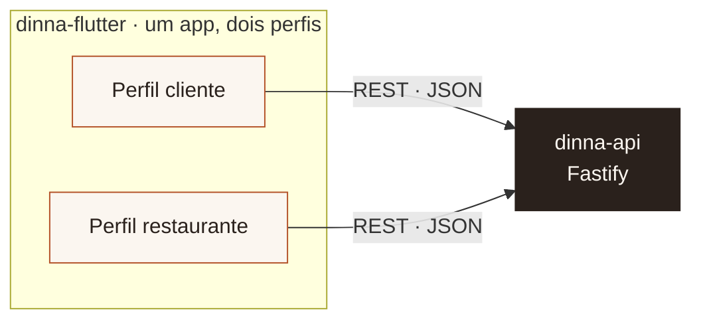
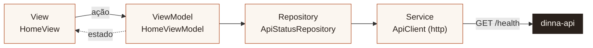

<a id="topo"></a>

<p align="center">
  <picture>
    <source media="(prefers-reduced-motion: reduce)" srcset="docs/assets/readme/hero-still.svg" />
    
  </picture>
</p>

<h1 align="center">dinna-flutter</h1>

<p align="center">
  <strong>Pedido à mesa, do seu jeito.</strong><br />
  O aplicativo Flutter do Dinna: a experiência do cliente e a operação do restaurante em um único app.
</p>

<p align="center">
  <a href="#comece-aqui"><strong>COMEÇAR →</strong></a>
  &nbsp;·&nbsp;
  <a href="#arquitetura">ARQUITETURA</a>
  &nbsp;·&nbsp;
  <a href="#estado-atual">O QUE JÁ EXISTE</a>
  &nbsp;·&nbsp;
  <a href="#roadmap">ROADMAP</a>
  &nbsp;·&nbsp;
  <a href="CONTRIBUTING.md">CONTRIBUIR</a>
  &nbsp;·&nbsp;
  <a href="https://github.com/jeancarlosaps/dinna-api">BACKEND REST DO DINNA</a>
</p>

<p align="center">
  <a href="https://github.com/jeancarlosaps/dinna-flutter/actions/workflows/ci.yml"></a>
  
  
  
  
</p>

---

## Ecossistema Dinna

O Dinna é formado por dois repositórios que trabalham juntos:

| Repositório | Papel | Stack |
|---|---|---|
| **dinna-flutter** (este) | App único com dois perfis: **cliente** (mesa, cardápio, carrinho, pedido) e **restaurante** (fila, status, cardápio) | Flutter · Dart · Material 3 |
| [**dinna-api**](https://github.com/jeancarlosaps/dinna-api) | Backend REST do Dinna: produtos, pedidos, status e, depois, recomendações | Node.js · TypeScript · Fastify |



Hoje o único contrato implementado entre os dois é `GET /health`. Os demais estão no [contrato REST da API](https://github.com/jeancarlosaps/dinna-api/blob/main/docs/api-contract.md), em rascunho.

---

## 01 · O produto

O Dinna é um app de pedidos feitos **dentro do restaurante**. **Não é delivery.**

Em restaurantes, pizzarias e bares com atendimento à mesa, boa parte do pedido depende de um atendente estar livre: para trazer o cardápio, tirar dúvidas, anotar o pedido e contar em que etapa ele está. No horário de pico, o tempo entre *“já sei o que quero”* e *“a cozinha recebeu meu pedido”* passa a depender mais da equipe do que do cliente.

O Dinna encurta esse intervalo **sem substituir o atendimento humano**:

- o cliente identifica a mesa, explora o cardápio, monta o carrinho, envia o pedido e acompanha o status;
- o restaurante recebe os pedidos em fila, atualiza o preparo e mantém o cardápio em dia;
- na release R2, o recurso **“Me ajuda a escolher”** vai sugerir pratos com base nas preferências do cliente e no cardápio real.

> As personas e o problema vêm da Atividade 1 de Gestão de Projetos: Marina (cliente) e Ricardo (restaurante). As hipóteses ainda não foram validadas com usuários reais.

<a id="estado-atual"></a>

## 02 · Estado atual

Fundação (R0) **em andamento**. Nenhuma tela de produto foi implementada ainda.

| Item | Situação | Onde |
|---|---|---|
| Projeto Flutter (Android + iOS) | ✅ Executa no **Android Emulator** (API 36) e no **iOS Simulator** (iPhone 17) | `android/`, `ios/` |
| MVVM com fluxo de referência | ✅ View → ViewModel → Repository → Service (`ApiClient`) → `GET /health` | `lib/features/home/`, [`docs/ARCHITECTURE.md`](docs/ARCHITECTURE.md) |
| Tema Dinna (Material 3) | ✅ Paleta e componentes base do tema | `lib/app/theme/` |
| URL da API por ambiente | ✅ `--dart-define=API_BASE_URL` com padrão por plataforma | `lib/core/config/` |
| Cliente HTTP + erro uniforme | ✅ `ApiClient` + `ApiException` | `lib/core/network/` |
| Testes, lint, format, CI | ✅ 17 testes · `flutter analyze --fatal-infos` · GitHub Actions | `test/`, `.github/` |
| Models (`Product`, `CartItem`, `Order`, `Preference`) | ⬜ Não implementado (SCRUM-22) | — |
| Rotas do cliente e do restaurante | ⬜ Não implementado (SCRUM-23) | — |
| Persistência local | ⬜ Mecanismo a definir (SCRUM-27) | — |
| Componentes visuais reutilizáveis | ⬜ Não implementado (parte da SCRUM-28) | — |
| Telas de R1, R2 e R3 | ⬜ Planejado | — |

---

## 03 · Experiência planejada

<p align="center">
  
</p>

Tudo nesta seção é **planejado para a R1** e ainda não existe no código.

**Cliente (Marina)**

| Etapa | O que faz | Epic |
|---|---|---|
| Mesa | Informa o número da mesa manualmente (QR Code fica para a R3) | E2 |
| Cardápio | Navega por categorias, busca e vê produtos indisponíveis | E2 |
| Produto | Vê imagem, descrição e preço; escolhe a quantidade | E3 |
| Carrinho | Adiciona, altera quantidade, remove e confere o total | E4 |
| Pedido | Envia o pedido da mesa e recebe a confirmação | E5 |
| Acompanhamento | Segue o status: Recebido → Preparando → Pronto → Finalizado | E6 |

**Restaurante (Ricardo)**

| Etapa | O que faz | Epic |
|---|---|---|
| Fila | Recebe os pedidos das mesas | E7 |
| Detalhes | Vê itens, quantidades e observações | E7 |
| Preparo | Atualiza o status do pedido | E7 |
| Finalização | Marca o pedido como finalizado | E7 |
| Cardápio | Cria, edita, desativa e controla a disponibilidade dos produtos | E8 |

---

## 04 · Stack

| Camada | Escolha | Por quê |
|---|---|---|
| UI | Flutter 3.47.7 (stable), Material 3 | Um código para Android e iOS; Material 3 com tema próprio |
| Linguagem | Dart 3.13.5, null safety | Padrão do Flutter stable |
| Estado | `ChangeNotifier` + `ListenableBuilder` | Nativos do Flutter e suficientes para MVVM; sem dependência extra |
| HTTP | [`http`](https://pub.dev/packages/http) 1.6.0 | Pacote oficial do time Dart, testável com `MockClient` |
| Navegação | `onGenerateRoute` nativo | Poucas rotas por enquanto; `go_router` pode entrar na SCRUM-23 se fizer falta |
| Lint | `flutter_lints` 6.0.0 + regras em `analysis_options.yaml` | Análise estrita (`strict-casts`, `strict-raw-types`) |

Dependências diretas: `http` e `cupertino_icons`, que veio no template do Flutter. Nenhuma biblioteca de estado, injeção de dependência ou armazenamento foi adicionada.

<a id="arquitetura"></a>

## 05 · Arquitetura MVVM



| Camada | Responsabilidade | Não pode |
|---|---|---|
| **View** | Desenhar o estado e repassar ações do usuário | Ter regra de negócio ou chamar HTTP |
| **ViewModel** | Guardar loading, success e error e orquestrar a ação | Conhecer widget, `http` ou `ApiException` |
| **Repository** | Entregar dados ao ViewModel e traduzir payload e falhas do Service | Conhecer UI ou estado visual |
| **Service (`ApiClient`)** | HTTP, serialização, timeout e status code; falhas viram `ApiException` | Conhecer regra de negócio ou estado de tela |

O contrato completo, as dependências permitidas, o passo a passo do `GET /health` e como criar a próxima feature estão em [`docs/ARCHITECTURE.md`](docs/ARCHITECTURE.md).

Regras que o código já segue:

- As dependências são montadas em [`lib/main.dart`](lib/main.dart) e passadas por construtor. Não há service locator.
- O ViewModel nasce no `State` da tela (`createViewModel`) e é descartado no `dispose`.
- O Repository traduz `ApiException` em `ApiAvailability`. O ViewModel só vê online, offline e a mensagem.
- O `ApiClient` lê o formato de erro da API (`{ "error": { "code", "message" } }`) e converte falhas de rede, timeout, HTTP e corpo que não é JSON em `ApiException`.

### Estrutura real

```text
lib/
├── main.dart                         # composição: AppConfig, ApiClient, repositories
├── app/
│   ├── app.dart                      # MaterialApp + tema + rotas
│   ├── router/app_router.dart        # nomes de rota e onGenerateRoute
│   └── theme/
│       ├── dinna_colors.dart         # paleta Dinna
│       └── dinna_theme.dart          # ThemeData Material 3
├── core/
│   ├── config/app_config.dart        # API_BASE_URL por ambiente
│   └── network/
│       ├── api_client.dart           # Service HTTP
│       └── api_exception.dart        # erro uniforme
└── features/
    └── home/                         # fluxo de referência (tela provisória)
        ├── api_status_repository.dart
        ├── http_api_status_repository.dart
        ├── home_view.dart
        └── home_view_model.dart
test/                                 # espelha lib/ (17 testes)
docs/ARCHITECTURE.md                  # contrato das camadas MVVM
docs/assets/readme/                   # ilustrações deste README
```

Novas features entram em `lib/features/<feature>/` (`table`, `menu`, `product`, `cart`, `orders`, `restaurant`, `recommendation`). Models compartilhados vão em `lib/shared/models/` e widgets reutilizáveis em `lib/shared/widgets/`. Essas pastas são criadas junto com o primeiro arquivo.

<a id="comece-aqui"></a>

## 06 · Comece aqui

### 1. Instale o Flutter

Siga o guia oficial da sua plataforma: <https://docs.flutter.dev/get-started/install>. Use o canal **stable**, versão **3.47.x**.

O SDK pode ficar em qualquer pasta. Uma alternativa portável é clonar o canal stable e adicionar `bin/` ao `PATH`:

```bash
git clone --depth 1 -b stable https://github.com/flutter/flutter.git ~/development/flutter
export PATH="$HOME/development/flutter/bin:$PATH"   # adicione ao seu ~/.zshrc ou ~/.bashrc
flutter --version
```

### 2. Prepare o ambiente

```bash
flutter doctor
```

| Plataforma | O que o `flutter doctor` precisa mostrar |
|---|---|
| iOS (macOS) | `[✓] Xcode` |
| Android | `[✓] Android toolchain`: Android SDK, `cmdline-tools` e licenças aceitas (`flutter doctor --android-licenses`) |

### 3. Clone e instale as dependências

```bash
git clone git@github.com:jeancarlosaps/dinna-flutter.git
cd dinna-flutter
flutter pub get
```

### 4. Suba a API

O app conversa com o [dinna-api](https://github.com/jeancarlosaps/dinna-api) na porta `3333`. Siga o README da API e deixe `npm run dev` rodando.

### 5. Configure a URL da API

Sem configuração, o app escolhe a URL pela plataforma ([`app_config.dart`](lib/core/config/app_config.dart)):

| Onde o app roda | URL padrão | Por quê |
|---|---|---|
| iOS Simulator | `http://localhost:3333` | O simulador usa a rede do Mac |
| Android Emulator | `http://10.0.2.2:3333` | `10.0.2.2` é o alias do computador host dentro do emulador |
| Dispositivo físico | — (obrigatório informar) | Use o IP do computador na rede local |

Para mudar, passe `--dart-define=API_BASE_URL=<url>` no `flutter run`. Nenhuma credencial vai no código nem no `--dart-define`.

> **HTTP sem TLS.** O app usa `package:http`, que abre sockets do próprio Dart (`dart:io`). Desde o Flutter 2.2, esses sockets não seguem a política de cleartext da plataforma ([documentação](https://docs.flutter.dev/release/breaking-changes/network-policy-ios-android)), por isso `http://` para a API local não precisa de `networkSecurityConfig` (Android) nem de exceção ATS (iOS). Se algum dia o app passar a usar um cliente HTTP nativo da plataforma, essas configurações passam a ser necessárias. O manifesto principal do Android declara `INTERNET`, porque o release não herda a permissão que o Flutter coloca só em debug e profile. No Android Emulator, com a API fora do ar, o botão “Verificar conexão com a API” mostrou “Não foi possível conectar à API”. Dispositivo físico ainda não foi testado.

### 6. Execute no iOS

```bash
open -a Simulator
flutter run
```

### 7. Execute no Android

```bash
flutter emulators                     # lista os emuladores disponíveis
flutter emulators --launch <id>
flutter run
```

> **Android validado em debug.** Em 24/10/2026 o app foi instalado e aberto no emulador `Dinna_Phone_API_36.1` (API 36, arm64). O `flutter doctor` desta máquina ainda aponta `cmdline-tools` ausente; o Gradle aceitou a licença do NDK que já estava no SDK e concluiu o `assembleDebug`. A CI continua sem compilar Android nem iOS.

### 8. Dispositivo físico

Com o celular e o computador na mesma rede, e a API escutando em `0.0.0.0` (padrão do `.env.example` da API):

```bash
flutter run --dart-define=API_BASE_URL=http://<IP-do-computador>:3333
```

Na tela inicial, toque em **“Verificar conexão com a API”**: com a API no ar, o card mostra **“API online”**.

---

## 07 · Testes e qualidade

| Comando | O que faz |
|---|---|
| `flutter test` | Testes unitários e de widget |
| `flutter analyze --fatal-infos` | Análise estática; qualquer aviso faz o comando falhar |
| `dart format .` | Formata o código (largura 100) |
| `dart format --output=none --set-exit-if-changed .` | Só verifica a formatação, como na CI |

O que os 17 testes cobrem hoje:

| Arquivo | Cobre |
|---|---|
| `test/app_test.dart` | O app inicia com o tema Dinna; o fluxo View → ViewModel → Repository |
| `test/core/app_config_test.dart` | URL padrão por plataforma e prioridade do `API_BASE_URL` |
| `test/core/api_client_test.dart` | Montagem da URL, erro da API, falha de rede e corpo que não é JSON |
| `test/features/home/api_status_repository_test.dart` | Tradução de `/health`: ok, payload inesperado, rede e HTTP inválido |
| `test/features/home/home_view_model_test.dart` | `checking` antes da resposta, success, error e `dispose` |

### `flutter analyze` em pastas com acento

| | |
|---|---|
| **Sintoma** | `FormatException: Unexpected end of input` ao rodar `flutter analyze` |
| **Quando** | O caminho do projeto tem caractere não ASCII (ex.: `PósMobile-UTFPR`). Reproduzido no Flutter 3.47.7 com um projeto mínimo |
| **Causa** | O `flutter_tools` envia o cabeçalho `Content-Length` do protocolo LSP contando caracteres, quando deveria contar bytes UTF-8. Com acento no caminho, a mensagem chega cortada ao servidor de análise |
| **Workaround** | `dart analyze --fatal-infos`, que não usa esse canal e mostra os mesmos diagnósticos |
| **Correção definitiva** | Depende de uma correção no Flutter. A CI não é afetada (o caminho no runner é ASCII) |

Não renomeie pastas nem altere o SDK para contornar o problema.

---

## 08 · CI

O workflow [`.github/workflows/ci.yml`](.github/workflows/ci.yml) roda em todo push na `main` e em todo pull request:

```text
checkout → Flutter 3.47.7 (stable) → flutter pub get → dart format (check) → flutter analyze --fatal-infos → flutter test
```

Não há deploy, assinatura nem publicação em loja, e a CI não compila Android nem iOS.

---

## 09 · Integração com o backend

| Contrato | Situação | Usado por |
|---|---|---|
| `GET /health` → `{ "status": "ok" }` | **Implementado** nos dois lados | `ApiStatusRepository` |
| Formato de erro `{ "error": { "code", "message" } }` | **Implementado** nos dois lados | `ApiClient` |
| `/products`, `/orders`, `/orders/:id/status` | **Planejado** (R1), contrato em rascunho | — |
| `/ai/recommendation` | **Planejado** (R2) | — |

Fonte do contrato: [`dinna-api/docs/api-contract.md`](https://github.com/jeancarlosaps/dinna-api/blob/main/docs/api-contract.md). Ele vira definitivo com o aceite da SCRUM-24.

<a id="roadmap"></a>

## 10 · Roadmap

<p align="center">
  
</p>

Situação das tasks R0 que tocam este repositório. A coluna **Jira** é o status no board em 16/10/2026; a coluna **Código** é o que existe nesta branch.

| Issue | Task | Jira | Código |
|---|---|---|---|
| SCRUM-16 | Criar e configurar o projeto Flutter | A fazer | Executa no Android e no iOS; estrutura de pastas definida. O `http` já está no `pubspec`. O armazenamento local continua na SCRUM-27 |
| SCRUM-19 | Estruturar a arquitetura MVVM | A fazer | Contrato em `docs/ARCHITECTURE.md`; `GET /health` é o fluxo de referência |
| SCRUM-22 | Definir os models principais | A fazer | Não iniciado |
| SCRUM-23 | Configurar a navegação base | A fazer | Não iniciado (só existe a estrutura de rotas) |
| SCRUM-26 | Configurar o cliente HTTP | A fazer | `ApiClient` centralizado com erro uniforme; falta revisão |
| SCRUM-27 | Definir a persistência local | A fazer | Não iniciado |
| SCRUM-28 | Estrutura visual base | Em andamento | Tema pronto; faltam os componentes reutilizáveis |

As releases seguintes (R1 MVP Operacional, R2 Dinna, R3 Evoluções) estão no Jira, sem datas definidas. Em 24/10/2026 a SCRUM-16 está *Em andamento*.

---

## 11 · Como contribuir

O fluxo completo está em [CONTRIBUTING.md](CONTRIBUTING.md). Em resumo:

1. Pegue uma issue no [Jira (SCRUM)](https://jeancarlosaps.atlassian.net/jira/software/projects/SCRUM/boards/1).
2. Crie a branch a partir da `main`: `feature/SCRUM-<n>-descricao`, `fix/SCRUM-<n>-descricao` ou `chore/SCRUM-<n>-descricao`.
3. Valide antes do PR: `dart format . && flutter analyze --fatal-infos && flutter test`.
4. Abra o PR usando o [template](.github/pull_request_template.md), com a CI verde e a revisão de outro integrante.

## 12 · Equipe

| Integrante | Foco planejado no backlog |
|---|---|
| Jean Carlos | Arquitetura e fundação do app, QA de arquitetura |
| Felipe Souza | Contrato REST, cliente HTTP, backend e fluxo do restaurante |
| Gabriel Abreu | Experiência do cliente e estrutura visual |
| João Victor | Persistência local e evoluções |

Os focos vêm da distribuição de issues no backlog (Atividade 2) e não são cargos formais.

## 13 · Próximos passos

1. **SCRUM-22 / SCRUM-24:** fechar o contrato REST e criar os models a partir dele.
2. **SCRUM-23:** definir as rotas do cliente e do restaurante.
3. **SCRUM-27:** escolher o armazenamento local (carrinho, preferências, último pedido).
4. **SCRUM-28:** criar os componentes Dinna reutilizáveis em cima do tema.
5. **Ambiente:** instalar `cmdline-tools` para o `flutter doctor` ficar verde. O debug Android já executa sem esse componente.

## 14 · Links

- Jira (SCRUM): <https://jeancarlosaps.atlassian.net/jira/software/projects/SCRUM/boards/1>
- Figma: <https://www.figma.com/design/xYeeN6UBmj3lF458GF9qwA/Dinna-%C2%B7-App-Cliente?node-id=0-1>
- Backend REST do Dinna: <https://github.com/jeancarlosaps/dinna-api>
- Sistema visual dos READMEs: [docs/assets/readme/DESIGN.md](docs/assets/readme/DESIGN.md)

<p align="center"><sub>Projeto acadêmico · Pós Mobile UTFPR · disciplina de Flutter · <a href="#topo">voltar ao topo ↑</a></sub></p>
