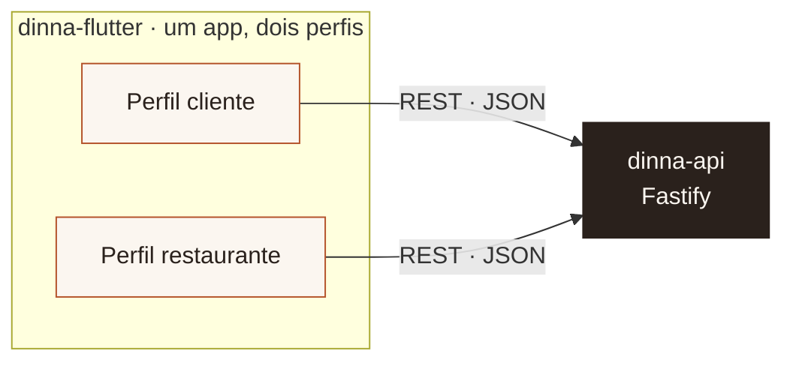
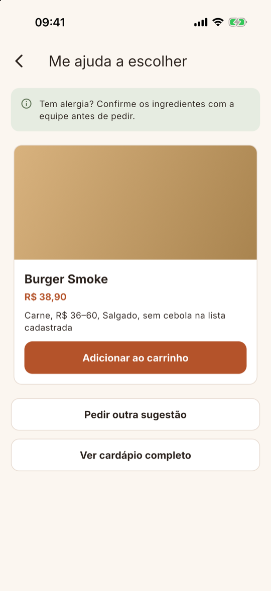
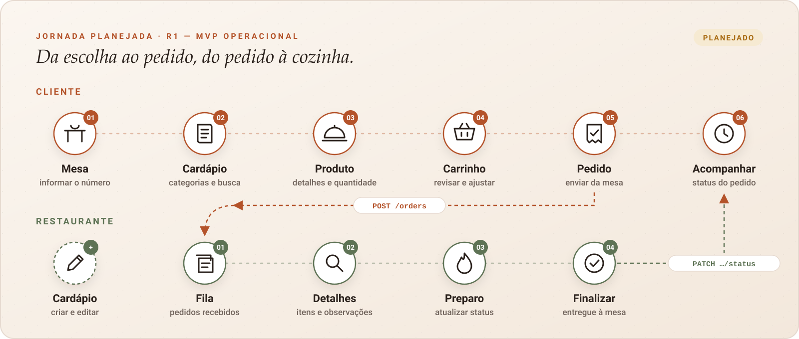
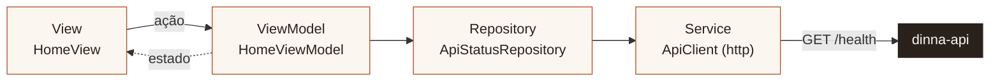
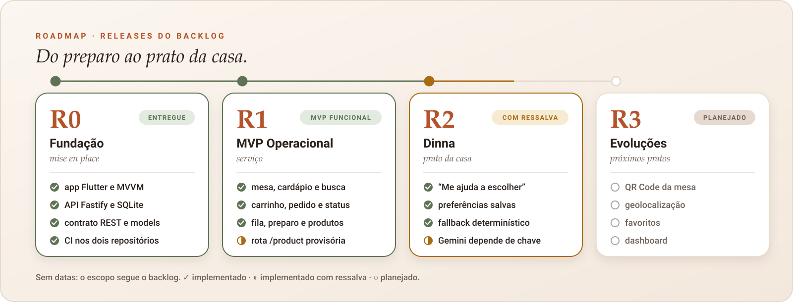

<a id="topo"></a>

<p align="center">
  <picture>
    <source media="(prefers-reduced-motion: reduce)" srcset="docs/assets/readme/hero-still.svg" />
    
  </picture>
</p>

<h1 align="center">dinna-flutter</h1>

<p align="center">
  <strong>Pedido à mesa, do seu jeito.</strong><br />
  O aplicativo Flutter do Dinna: a experiência do cliente e a operação do restaurante em um único app.
</p>

<p align="center">
  <a href="#comece-aqui"><strong>COMEÇAR →</strong></a>
  &nbsp;·&nbsp;
  <a href="#conheca-o-dinna">CONHEÇA O DINNA</a>
  &nbsp;·&nbsp;
  <a href="#arquitetura">ARQUITETURA</a>
  &nbsp;·&nbsp;
  <a href="#estado-atual">O QUE JÁ EXISTE</a>
  &nbsp;·&nbsp;
  <a href="#documentacao-do-projeto">DOCUMENTAÇÃO</a>
  &nbsp;·&nbsp;
  <a href="#roadmap">ROADMAP</a>
  &nbsp;·&nbsp;
  <a href="CONTRIBUTING.md">CONTRIBUIR</a>
  &nbsp;·&nbsp;
  <a href="https://github.com/jeancarlosaps/dinna-api">BACKEND REST DO DINNA</a>
</p>

<p align="center">
  <a href="https://github.com/jeancarlosaps/dinna-flutter/actions/workflows/ci.yml"></a>
  
  
  
  
</p>

---

## Ecossistema Dinna

O Dinna é formado por dois repositórios que trabalham juntos:

| Repositório | Papel | Stack |
|---|---|---|
| **dinna-flutter** (este) | App único com dois perfis: **cliente** (mesa, cardápio, carrinho, pedido) e **restaurante** (fila, status, cardápio) | Flutter · Dart · Material 3 |
| [**dinna-api**](https://github.com/jeancarlosaps/dinna-api) | Backend REST do Dinna: produtos, pedidos, status e recomendação de pratos | Node.js · TypeScript · Fastify |



O app consome todos os endpoints do [contrato REST](https://github.com/jeancarlosaps/dinna-api/blob/dev/docs/api-contract.md): `/health`, `/products`, `/orders`, `/orders/:id/status` e `/ai/recommendation`. A tabela completa está em [Integração com o backend](#integracao-backend).

<a id="conheca-o-dinna"></a>

## Conheça o Dinna

Capturas reais do app no iOS Simulator (iPhone 17), rodando a `dev` contra a API local com o cardápio de demonstração. Mesa, pedido e produtos são dados de teste.

<table>
  <tr>
    <td align="center" width="33%">
      <br />
      <sub><strong>Tela inicial</strong><br />Entrada do cliente e do restaurante, com o último pedido salvo no aparelho</sub>
    </td>
    <td align="center" width="33%">
      <br />
      <sub><strong>Cardápio</strong><br />Categorias, busca pelo nome e acesso ao carrinho</sub>
    </td>
    <td align="center" width="33%">
      <br />
      <sub><strong>“Me ajuda a escolher”</strong><br />Preferências salvas no aparelho e aviso de alergia</sub>
    </td>
  </tr>
  <tr>
    <td align="center" width="33%">
      <br />
      <sub><strong>Sugestões de pratos</strong><br />Seleção pelo cardápio real; aqui, o fallback sem Gemini</sub>
    </td>
    <td align="center" width="33%">
      <br />
      <sub><strong>Carrinho</strong><br />Quantidade, remoção, total estimado e envio</sub>
    </td>
    <td align="center" width="33%">
      <br />
      <sub><strong>Painel do restaurante</strong><br />Fila com filtros por status e gestão de produtos</sub>
    </td>
  </tr>
</table>

> A tela de sugestões mostra o caminho sem chave do Gemini: a API escolhe os pratos por regras determinísticas e o app avisa que “A Dinna não respondeu agora”. Não é texto gerado por IA. Com `GEMINI_API_KEY` configurada no backend, a mesma tela mostra a escolha do modelo, sempre limitada aos pratos do cardápio.

<a id="documentacao-do-projeto"></a>

## Documentação do projeto

A gestão do Dinna está no Confluence: **[Documentação de Gestão do Projeto](https://jeancarlosaps.atlassian.net/wiki/spaces/DD/pages/9142274)**.

O espaço reúne o planejamento, o backlog, os story maps, o roadmap, a matriz de riscos, o acompanhamento das sprints com burndowns, as reviews, as retrospectivas e as lições aprendidas. Este README cobre o código; o Confluence cobre o processo.

---

## 01 · O produto

O Dinna é um app de pedidos feitos **dentro do restaurante**. **Não é delivery.**

Em restaurantes, pizzarias e bares com atendimento à mesa, boa parte do pedido depende de um atendente estar livre: para trazer o cardápio, tirar dúvidas, anotar o pedido e contar em que etapa ele está. No horário de pico, o tempo entre *“já sei o que quero”* e *“a cozinha recebeu meu pedido”* passa a depender mais da equipe do que do cliente.

O Dinna encurta esse intervalo **sem substituir o atendimento humano**:

- o cliente identifica a mesa, explora o cardápio, monta o carrinho, envia o pedido e acompanha o status;
- o restaurante recebe os pedidos em fila, atualiza o preparo e mantém o cardápio em dia;
- o recurso **“Me ajuda a escolher”** (R2) sugere pratos com base nas preferências do cliente e no cardápio real, com Gemini opcional e fallback determinístico no backend.

> As personas e o problema vêm da Atividade 1 de Gestão de Projetos: Marina (cliente) e Ricardo (restaurante). As hipóteses ainda não foram validadas com usuários reais.

<a id="estado-atual"></a>

## 02 · Estado atual

MVP da entrega acadêmica integrado na `dev`: fundação (R0), jornada operacional do cliente e do restaurante (R1) e “Me ajuda a escolher” (R2). A home em `/` separa as entradas **Sou cliente** e **Restaurante**, mostra o último pedido salvo e mantém a verificação de `GET /health`. O cliente valida a mesa, navega pelo cardápio, vê o detalhe do produto, monta o carrinho, envia o pedido e acompanha o status, que se atualiza sozinho. O restaurante acompanha a fila, avança o status dos pedidos e gerencia o cardápio. As evoluções da R3, como QR Code da mesa, seguem planejadas.

| Item | Situação | Onde |
|---|---|---|
| Projeto Flutter (Android + iOS) | ✅ Executa no **Android Emulator** (API 36) e no **iOS Simulator** (iPhone 17) | `android/`, `ios/` |
| MVVM | ✅ View → ViewModel → Repository → Service (`ApiClient`) em todas as features | `lib/features/`, [`docs/ARCHITECTURE.md`](docs/ARCHITECTURE.md) |
| Tema Dinna (Material 3) | ✅ Paleta, tipografia (Inter e Source Serif 4), botões e raios do Figma; `DinnaLogo`, `DinnaBanner` e `DinnaEmptyState` (SCRUM-28) | `lib/app/theme/`, `lib/shared/widgets/` |
| URL e token da API | ✅ `API_BASE_URL` com padrão por plataforma; `API_TOKEN` opcional (SCRUM-92) | `lib/core/config/` |
| Cliente HTTP + erro uniforme | ✅ `ApiClient` + `ApiException`; HTTP 401 tratado como recusa do envio (SCRUM-95) | `lib/core/network/` |
| Testes, lint, format, CI | ✅ 657 testes · `flutter analyze --fatal-infos` · GitHub Actions | `test/`, `.github/` |
| Home | ✅ Entradas do cliente e do restaurante e último pedido confirmado (SCRUM-98, SCRUM-72) | [`lib/features/home/`](lib/features/home/) |
| Mesa (`/table`) | ✅ Valida a mesa de 1 a 999 e abre o cardápio com ela (SCRUM-29) | [`lib/features/client/table/`](lib/features/client/table/) |
| Cardápio (`/menu`) | ✅ `GET /products` agrupado por categoria, chips de filtro, busca pelo nome sem diferenciar maiúsculas nem acentos, selo “Esgotado” e acesso ao carrinho (SCRUM-30, SCRUM-33, SCRUM-39) | [`lib/features/menu/`](lib/features/menu/) |
| Detalhe do produto | ✅ Bottom sheet com descrição, ingredientes na ordem da API e quantidade de 1 a 99 (SCRUM-36, SCRUM-37, SCRUM-38) | [`lib/features/menu/product_detail_view.dart`](lib/features/menu/product_detail_view.dart) |
| Carrinho (`/cart`) | ✅ Quantidade, remoção, total estimado e sessão persistida em SQLite (SCRUM-40, SCRUM-69, SCRUM-70) | [`lib/features/client/cart/`](lib/features/client/cart/) |
| Envio do pedido | ✅ `POST /orders` com `Idempotency-Key`, intenção salva antes do envio, erro com nova tentativa e fluxo encerrado após a confirmação (SCRUM-41, SCRUM-43, SCRUM-90, SCRUM-93) | [`lib/features/client/order/`](lib/features/client/order/) |
| Confirmação e acompanhamento | ✅ `/order` mostra o número público do pedido (SCRUM-44, SCRUM-94). `/order/tracking` consulta o status a cada 5 s e pausa em segundo plano (SCRUM-46) | [`lib/features/client/order/`](lib/features/client/order/) |
| “Me ajuda a escolher” (`/recommendation`) | ✅ Formulário, sugestões com dados do cardápio, “Adicionar ao carrinho”, “Pedir outra sugestão” e preferências salvas no aparelho (SCRUM-61, SCRUM-64, SCRUM-65, SCRUM-66, SCRUM-68) | [`lib/features/recommendation/`](lib/features/recommendation/) |
| Fila do restaurante (`/restaurant`) | ✅ Pedidos por status, atualização a cada 10 s, detalhe e avanço Recebido → Preparando → Pronto → Finalizado (SCRUM-48, SCRUM-49, SCRUM-50) | [`lib/features/restaurant/`](lib/features/restaurant/) |
| Cardápio do restaurante (`/restaurant/menu`) | ✅ Lista, cadastro, edição e desativação (soft-delete) de produtos (SCRUM-55) | [`lib/features/restaurant/product_catalog_view.dart`](lib/features/restaurant/product_catalog_view.dart) |
| Persistência local | ✅ SQLite versionado para carrinho e último pedido; intenção do pedido e preferências da recomendação em arquivo (SCRUM-70, SCRUM-72, SCRUM-90, SCRUM-68) | [`lib/core/storage/`](lib/core/storage/) |
| Rota `/product` | ⬜ Segue como `RoutePlaceholder`: o detalhe do produto abre como bottom sheet sobre o cardápio | [`lib/app/router/`](lib/app/router/) |
| R3 (QR Code da mesa e evoluções) | ⬜ Planejado | — |

---

## 03 · Jornada do produto

<p align="center">
  
</p>

A jornada da **R1** está implementada na `dev`, nas duas pontas. A única etapa que segue como planejada é a leitura da mesa por QR Code, prevista para a R3; hoje a mesa é digitada. O detalhe do produto abre como bottom sheet sobre o cardápio, por isso a rota `/product` continua como placeholder. O “Me ajuda a escolher” (R2) abre a partir do cardápio.

**Cliente (Marina)**

| Etapa | O que faz | Epic |
|---|---|---|
| Mesa | Informa o número da mesa manualmente (QR Code fica para a R3) | E2 |
| Cardápio | Navega por categorias, busca e vê produtos indisponíveis | E2 |
| Produto | Vê imagem, descrição e preço; escolhe a quantidade | E3 |
| Carrinho | Adiciona, altera quantidade, remove e confere o total | E4 |
| Pedido | Envia o pedido da mesa e recebe a confirmação | E5 |
| Acompanhamento | Segue o status: Recebido → Preparando → Pronto → Finalizado | E6 |

**Restaurante (Ricardo)**

| Etapa | O que faz | Epic |
|---|---|---|
| Fila | Recebe os pedidos das mesas | E7 |
| Detalhes | Vê itens, quantidades e observações | E7 |
| Preparo | Atualiza o status do pedido | E7 |
| Finalização | Marca o pedido como finalizado | E7 |
| Cardápio | Cria, edita, desativa e controla a disponibilidade dos produtos | E8 |

---

## 04 · Stack

| Camada | Escolha | Por quê |
|---|---|---|
| UI | Flutter 3.47.7 (stable), Material 3 | Um código para Android e iOS; Material 3 com tema próprio |
| Linguagem | Dart 3.13.5, null safety | Padrão do Flutter stable |
| Estado | `ChangeNotifier` + `ListenableBuilder` | Nativos do Flutter e suficientes para MVVM; sem dependência extra |
| HTTP | [`http`](https://pub.dev/packages/http) 1.6.0 | Pacote oficial do time Dart, testável com `MockClient` |
| Navegação | `onGenerateRoute` nativo | A SCRUM-23, concluída no PR #6, manteve o `Navigator` do Flutter. O mapa está em [`docs/ARCHITECTURE.md`](docs/ARCHITECTURE.md) |
| Lint | `flutter_lints` 6.0.0 + regras em `analysis_options.yaml` | Análise estrita (`strict-casts`, `strict-raw-types`) |

Dependências diretas: `http` 1.6.0, `sqflite` 2.4.5, `path` 1.9.1, `path_provider` 2.1.6 e `cupertino_icons`, que veio no template do Flutter. `sqflite` persiste as linhas do carrinho e o último pedido confirmado; `path_provider` localiza os arquivos da intenção de pedido e das preferências da recomendação. Nenhuma biblioteca de estado ou injeção de dependência foi adicionada.

<a id="arquitetura"></a>

## 05 · Arquitetura MVVM



| Camada | Responsabilidade | Não pode |
|---|---|---|
| **View** | Desenhar o estado e repassar ações do usuário | Ter regra de negócio ou chamar HTTP |
| **ViewModel** | Guardar loading, success e error e orquestrar a ação | Conhecer widget, `http` ou `ApiException` |
| **Repository** | Entregar dados ao ViewModel e traduzir payload e falhas do Service | Conhecer UI ou estado visual |
| **Service (`ApiClient`)** | HTTP, serialização, timeout e status code; falhas viram `ApiException` | Conhecer regra de negócio ou estado de tela |

O contrato completo, as dependências permitidas, o passo a passo do `GET /health` e como criar a próxima feature estão em [`docs/ARCHITECTURE.md`](docs/ARCHITECTURE.md).

Regras que o código já segue:

- As dependências são montadas em [`lib/main.dart`](lib/main.dart) e passadas por construtor. Não há service locator.
- O ViewModel nasce no `State` da tela (`createViewModel`) e é descartado no `dispose`.
- O Repository traduz `ApiException` em `ApiAvailability`. O ViewModel só vê online, offline e a mensagem. Outra falha tira a tela de `checking` e a leva a `offline` com um texto genérico, sem o detalhe interno. Depois do `dispose`, o ViewModel não altera estado nem notifica.
- O `ApiClient` lê o formato de erro da API (`{ "error": { "code", "message" } }`) e converte falhas de rede, timeout, HTTP e corpo que não é JSON em `ApiException`.

### Estrutura real

```text
lib/
├── main.dart                         # composição: AppConfig, ApiClient, repositories
├── app/
│   ├── app.dart                      # MaterialApp + tema + rotas
│   ├── router/
│   │   ├── app_router.dart           # nomes de rota e onGenerateRoute
│   │   └── route_placeholder.dart    # página mínima até a View da story
│   └── theme/                        # paleta, layout e ThemeData Material 3
├── core/
│   ├── config/app_config.dart        # API_BASE_URL e API_TOKEN por ambiente
│   ├── domain/                       # models compartilhados (SCRUM-22)
│   ├── network/                      # ApiClient (Service HTTP) e ApiException
│   └── storage/dinna_database.dart   # banco SQLite local versionado
├── features/
│   ├── home/                         # entradas do app e GET /health
│   ├── client/
│   │   ├── table/                    # mesa
│   │   ├── cart/                     # carrinho e sessão persistida
│   │   └── order/                    # envio, confirmação e acompanhamento
│   ├── menu/                         # cardápio e detalhe do produto
│   ├── recommendation/               # "Me ajuda a escolher"
│   └── restaurant/                   # fila, detalhe do pedido e cardápio do restaurante
└── shared/
    └── widgets/                      # DinnaLogo, DinnaBanner, DinnaEmptyState
test/                                 # espelha lib/ (657 testes)
docs/ARCHITECTURE.md                  # contrato das camadas MVVM
docs/assets/readme/                   # ilustrações deste README
docs/assets/screenshots/              # capturas do app usadas neste README
```

Cada feature segue a mesma divisão em View, ViewModel e Repository. Os models compartilhados ficam em `lib/core/domain/`. Os widgets usados por mais de uma feature ficam em `lib/shared/widgets/`.

O PR #3 também versionou dois PDFs em `lib/`: `Dinna · App Cliente Marina.pdf` (5,5 MB) e `Dinna · App Restaurante Ricardo.pdf` (8,6 MB). Eles não estão declarados como asset no `pubspec` e não são código da feature. Ficam no clone, ao lado dos fontes, e aumentam o repositório. A retirada fica para outro PR.

<a id="comece-aqui"></a>

## 06 · Comece aqui

### 1. Instale o Flutter

Siga o guia oficial da sua plataforma: <https://docs.flutter.dev/get-started/install>. Use o canal **stable**, versão **3.47.x**.

O SDK pode ficar em qualquer pasta. Uma alternativa portável é clonar o canal stable e adicionar `bin/` ao `PATH`:

```bash
git clone --depth 1 -b stable https://github.com/flutter/flutter.git ~/development/flutter
export PATH="$HOME/development/flutter/bin:$PATH"   # adicione ao seu ~/.zshrc ou ~/.bashrc
flutter --version
```

### 2. Prepare o ambiente

```bash
flutter doctor
```

| Plataforma | O que o `flutter doctor` precisa mostrar |
|---|---|
| iOS (macOS) | `[✓] Xcode` |
| Android | `[✓] Android toolchain`: Android SDK, `cmdline-tools` e licenças aceitas (`flutter doctor --android-licenses`) |

### 3. Clone e instale as dependências

```bash
git clone git@github.com:jeancarlosaps/dinna-flutter.git
cd dinna-flutter
flutter pub get
```

### 4. Suba a API

O app conversa com o [dinna-api](https://github.com/jeancarlosaps/dinna-api) na porta `3333`. Siga o README da API e deixe `npm run dev` rodando.

### 5. Configure a URL da API

Sem configuração, o app escolhe a URL pela plataforma ([`app_config.dart`](lib/core/config/app_config.dart)):

| Onde o app roda | URL padrão | Por quê |
|---|---|---|
| iOS Simulator | `http://localhost:3333` | O simulador usa a rede do Mac |
| Android Emulator | `http://10.0.2.2:3333` | `10.0.2.2` é o alias do computador host dentro do emulador |
| Dispositivo físico | — (obrigatório informar) | Use o IP do computador na rede local |

Para mudar a URL, passe `--dart-define=API_BASE_URL=<url>` no `flutter run`. O token de acesso, quando o ambiente exige, entra só por `--dart-define=API_TOKEN=<token>`. Ele não fica no código, no SQLite nem em preferências.

### Token da API protegida

A API local de desenvolvimento não pede token. `flutter run`, sem defines, continua apontando para `localhost` ou `10.0.2.2` e o `ApiClient` não envia `X-Dinna-Api-Token`.

Quando a URL HTTPS do Railway estiver confirmada, rode de novo com os dois defines. `API_BASE_URL` e `API_TOKEN` entram na compilação: um app já gerado para a API local não passa a usar o Railway sem um novo `flutter run`. O endereço abaixo é um placeholder: ainda não é a URL pública do deploy.

```bash
flutter run \
  --dart-define=API_BASE_URL="https://<url-publica-do-railway>" \
  --dart-define=API_TOKEN="<token-do-ambiente>"
```

O `ApiClient` acrescenta `X-Dinna-Api-Token` em todas as chamadas (GET, POST, PUT, PATCH e DELETE) somente se `API_TOKEN` tiver valor. `Content-Type`, `Idempotency-Key` e os demais headers do repositório permanecem. Não há login, JWT nem sessão de usuário.

`GET /health` segue sem autenticação no servidor. Se essa rota responde e uma rota de negócio volta **401** com `error.code` `UNAUTHORIZED`, o host está no ar e o token enviado não confere com o do servidor, ou o define não entrou na execução. Confira a presença dos dois defines sem imprimir o valor. A mensagem da API pode ir para a tela; o token não entra em log, relatório de erro nem interface. Não há nova tentativa automática. Carrinho, intenção de pedido e preferências da recomendação ficam no aparelho.

`--dart-define` não é cofre de segredo: o valor pode ser extraído de um aplicativo compilado. Serve só como mitigação temporária em builds controlados da equipe, para a apresentação. Não publique esse build em loja, não reutilize o token numa produção real e faça a rotação depois de 14/11/2026.

> **HTTP sem TLS.** O app usa `package:http`, que abre sockets do próprio Dart (`dart:io`). Desde o Flutter 2.2, esses sockets não seguem a política de cleartext da plataforma ([documentação](https://docs.flutter.dev/release/breaking-changes/network-policy-ios-android)), por isso `http://` para a API local não precisa de `networkSecurityConfig` (Android) nem de exceção ATS (iOS). Se algum dia o app passar a usar um cliente HTTP nativo da plataforma, essas configurações passam a ser necessárias. O manifesto principal do Android declara `INTERNET`, porque o release não herda a permissão que o Flutter coloca só em debug e profile. No Android Emulator, com a API fora do ar, o botão “Verificar conexão com a API” mostrou “Não foi possível conectar à API”. Dispositivo físico ainda não foi testado.

### 6. Execute no iOS

```bash
open -a Simulator
flutter run
```

### 7. Execute no Android

```bash
flutter emulators                     # lista os emuladores disponíveis
flutter emulators --launch <id>
flutter run
```

> **Android validado em debug.** Em 24/10/2026 o app foi instalado e aberto no emulador `Dinna_Phone_API_36.1` (API 36, arm64). O `flutter doctor` desta máquina ainda aponta `cmdline-tools` ausente; o Gradle aceitou a licença do NDK que já estava no SDK e concluiu o `assembleDebug`. A CI continua sem compilar Android nem iOS.

### 8. Dispositivo físico

Com o celular e o computador na mesma rede, e a API escutando em `0.0.0.0` (padrão do `.env.example` da API):

```bash
flutter run --dart-define=API_BASE_URL=http://<IP-do-computador>:3333
```

Na tela inicial, toque em **“Verificar conexão com a API”**: com a API no ar, o card mostra **“API online”**.

---

## 07 · Testes e qualidade

| Comando | O que faz |
|---|---|
| `flutter test` | Testes unitários e de widget |
| `flutter analyze --fatal-infos` | Análise estática; qualquer aviso faz o comando falhar |
| `dart format .` | Formata o código (largura 100) |
| `dart format --output=none --set-exit-if-changed .` | Só verifica a formatação, como na CI |

A `dev` tem 657 testes, todos verdes na CI do último merge (SCRUM-55). Principais áreas cobertas:

| Arquivo | Cobre |
|---|---|
| `test/app_test.dart` | O app inicia com o tema Dinna; o fluxo View → ViewModel → Repository |
| `test/app/app_router_test.dart` | Rota inicial `/`, `/table` com `TableView`, placeholder nas outras rotas do mapa, ida e volta, rota desconhecida e `GET /health` depois do retorno. O carrinho devolve a mesa ao cardápio |
| `test/core/domain/` | `fromJson` e `toJson` de `Product` (incluindo `ingredients`, resposta antiga e lista inválida), `Order`, `OrderItem`, `CartItem` e `Preference`. `lineId` fica no JSON local e não entra no item de `POST /orders` |
| `test/core/app_config_test.dart` | URL padrão por plataforma, prioridade do `API_BASE_URL` e `API_TOKEN` ausente ou preenchido |
| `test/core/api_client_test.dart` | Montagem da URL, erro da API, falha de rede e corpo que não é JSON |
| `test/core/api_access_token_test.dart` | Header opcional, preservação de `Idempotency-Key` e HTTP 401 sem apagar carrinho, intenção ou preferências |
| `test/features/home/api_status_repository_test.dart` | Tradução de `/health`: ok, payload inesperado, rede e HTTP inválido |
| `test/features/home/home_view_model_test.dart` | `checking` antes da resposta, success, error, exceção inesperada e `dispose` |
| `test/features/client/table/` | Validação da mesa (vazia, zero, letras, normalização) e navegação para `/menu` com a mesa |
| `test/features/menu/menu_view_model_test.dart`, `menu_view_test.dart` | Categorias sem repetir, filtro por categoria, busca pelo nome sem maiúsculas nem acentos (mantida ao recarregar), categoria que some ao recarregar volta para “Todos”, `load` depois do `dispose` sem efeito, falha e cardápio vazio; a tela mostra a mesa recebida, os produtos, o selo “Esgotado”, filtra pelo chip e pela busca, com aviso sem resultado, “Limpar busca” e busca dentro da categoria escolhida; o aviso cabe a 200% numa tela pequena. Erro e vazio cabem em 360×220. Chips a 200% e o nome a 300% não são cortados. A marca, a mesa curta e a mesa longa cabem no header a 300%. O recorte lateral não cobre os chips. Uma carga antiga não substitui a mais nova |
| `test/features/menu/product_detail_view_test.dart` | Detalhe com ingredientes na ordem da API e sem ingredientes (aviso para consultar o restaurante), produto esgotado, erro com nova tentativa, produto inexistente (volta ao cardápio, sem nova tentativa), quantidade entre 1 e 99 com o total no botão, quantidade mantida após nova tentativa, botão desabilitado sem `onAdd` ou com produto esgotado, texto a 200% sem corte, leitura conjunta dos ingredientes e da quantidade no leitor de tela, abertura do bottom sheet pelo card do cardápio e conteúdo acima da barra de navegação do sistema |
| `test/features/client/cart/` | Esquema do carrinho, `lineId`, reabertura, `removeConfirmed`, falha de SQLite sem tratar o carrinho como vazio, quantidade, remoção e total |
| `test/features/client/order/` | Envio com `Idempotency-Key`, intenção persistida, erro e nova tentativa, confirmação com número público, último pedido e acompanhamento periódico do status |
| `test/features/recommendation/` | Contrato de `/ai/recommendation`, fallback, preferências salvas, “Adicionar ao carrinho” e “Pedir outra sugestão” |
| `test/features/restaurant/` | Fila com atualização periódica, filtros por status, detalhe e avanço do pedido, cadastro, edição e desativação de produtos |
| `test/shared/widgets/` | `DinnaBanner` com e sem título; `DinnaEmptyState` com e sem ação |

### `flutter analyze` em pastas com acento

| | |
|---|---|
| **Sintoma** | `FormatException: Unexpected end of input` ao rodar `flutter analyze` |
| **Quando** | O caminho do projeto tem caractere não ASCII (ex.: `PósMobile-UTFPR`). Reproduzido no Flutter 3.47.7 com um projeto mínimo |
| **Causa** | O `flutter_tools` envia o cabeçalho `Content-Length` do protocolo LSP contando caracteres, quando deveria contar bytes UTF-8. Com acento no caminho, a mensagem chega cortada ao servidor de análise |
| **Workaround** | `dart analyze --fatal-infos`, que não usa esse canal e mostra os mesmos diagnósticos |
| **Correção definitiva** | Depende de uma correção no Flutter. A CI não é afetada (o caminho no runner é ASCII) |

Não renomeie pastas nem altere o SDK para contornar o problema.

---

## 08 · CI

O workflow [`.github/workflows/ci.yml`](.github/workflows/ci.yml) roda em todo push na `main` e em todo pull request:

```text
checkout → Flutter 3.47.7 (stable) → flutter pub get → dart format (check) → flutter analyze --fatal-infos → flutter test
```

Não há deploy, assinatura nem publicação em loja, e a CI não compila Android nem iOS.

---

<a id="integracao-backend"></a>

## 09 · Integração com o backend

| Contrato | Situação | Usado por |
|---|---|---|
| `GET /health` → `{ "status": "ok" }` | **Integrado** | `ApiStatusRepository` |
| Formato de erro `{ "error": { "code", "message" } }` | **Integrado** | `ApiClient` |
| `GET /products`, `GET /products/:id` | **Integrado** (R1) | `HttpProductRepository` (cardápio e detalhe) |
| `POST /products`, `PUT /products/:id`, `DELETE /products/:id` | **Integrado** (R1) | `HttpProductRepository` (cardápio do restaurante) |
| `POST /orders` com `Idempotency-Key` | **Integrado** (R1) | `HttpOrderRepository` (envio do pedido) |
| `GET /orders`, `GET /orders/:id` | **Integrado** (R1) | `HttpOrderRepository` (fila, detalhe e acompanhamento) |
| `PATCH /orders/:id/status` | **Integrado** (R1) | `HttpOrderRepository` (avanço do status) |
| `POST /ai/recommendation` | **Integrado** (R2) | `HttpRecommendationRepository` |

Fonte do contrato: [`dinna-api/docs/api-contract.md`](https://github.com/jeancarlosaps/dinna-api/blob/dev/docs/api-contract.md), aceito na SCRUM-24.

A recomendação respeita o campo `provider` da resposta. Com `answered`, a lista veio do Gemini, sempre validada contra o cardápio. Com `unavailable`, a API usou o fallback determinístico e o app mostra o aviso “A Dinna não respondeu agora”, sem apresentar a lista como resposta de IA.

<a id="roadmap"></a>

## 10 · Roadmap

<p align="center">
  
</p>

A ilustração é o desenho inicial do roadmap e não acompanha o andamento. A situação abaixo reflete o código na `dev`. O acompanhamento por sprint, com burndowns e reviews, está no [Confluence](#documentacao-do-projeto).

| Release | Escopo | Situação no código |
|---|---|---|
| **R0 · Fundação** | Projeto Flutter, MVVM, models, rotas, contrato REST, cliente HTTP, tema e persistência local | ✅ Concluída |
| **R1 · MVP operacional** | Mesa, cardápio, detalhe, carrinho, envio e acompanhamento do pedido; fila, status e cardápio do restaurante | ✅ Implementada |
| **R2 · “Me ajuda a escolher”** | Formulário de preferências, sugestões do cardápio real, adicionar ao carrinho, outra sugestão e preferências salvas | ✅ Implementada, com Gemini opcional e fallback determinístico no backend |
| **R3 · Evoluções** | QR Code da mesa e demais melhorias | ⬜ Planejada |

---

## 11 · Como contribuir

O fluxo completo está em [CONTRIBUTING.md](CONTRIBUTING.md). Em resumo:

1. Pegue uma issue no [Jira (SCRUM)](https://jeancarlosaps.atlassian.net/jira/software/projects/SCRUM/boards/1).
2. Crie a branch a partir da `main`: `feature/SCRUM-<n>-descricao`, `fix/SCRUM-<n>-descricao` ou `chore/SCRUM-<n>-descricao`.
3. Valide antes do PR: `dart format . && flutter analyze --fatal-infos && flutter test`.
4. Abra o PR usando o [template](.github/pull_request_template.md), com a CI verde e a revisão de outro integrante.

## 12 · Equipe

| Integrante | Foco planejado no backlog |
|---|---|
| Jean Carlos | Arquitetura e fundação do app, QA de arquitetura |
| Felipe Souza | Contrato REST, cliente HTTP, backend e fluxo do restaurante |
| Gabriel Abreu | Experiência do cliente e estrutura visual |
| João Victor | Persistência local e evoluções |

Os focos vêm da distribuição de issues no backlog (Atividade 2) e não são cargos formais.

## 13 · Próximos passos

1. **R3:** leitura da mesa por QR Code e as demais evoluções planejadas.
2. **Recomendação com Gemini:** configurar `GEMINI_API_KEY` no backend do ambiente de apresentação. Sem a chave, a sugestão segue pelo fallback determinístico.
3. **API hospedada:** o deploy no Railway está documentado na API, mas a URL pública ainda não foi confirmada neste README.
4. **PDFs em `lib/`:** o PR #3 versionou `Dinna · App Cliente Marina.pdf` (5,5 MB) e `Dinna · App Restaurante Ricardo.pdf` (8,6 MB) ao lado do código. Não são asset do app. A organização fica para outro PR.
5. **Ambiente:** instalar `cmdline-tools` para o `flutter doctor` ficar verde. O debug Android já executa sem esse componente.

## 14 · Links

- Documentação de Gestão do Projeto (Confluence): <https://jeancarlosaps.atlassian.net/wiki/spaces/DD/pages/9142274>
- Jira (SCRUM): <https://jeancarlosaps.atlassian.net/jira/software/projects/SCRUM/boards/1>
- Figma: <https://www.figma.com/design/xYeeN6UBmj3lF458GF9qwA/Dinna-%C2%B7-App-Cliente?node-id=0-1>
- Backend REST do Dinna: <https://github.com/jeancarlosaps/dinna-api>
- Sistema visual dos READMEs: [docs/assets/readme/DESIGN.md](docs/assets/readme/DESIGN.md)

<p align="center"><sub>Projeto acadêmico · Pós Mobile UTFPR · disciplina de Flutter · <a href="#topo">voltar ao topo ↑</a></sub></p>
