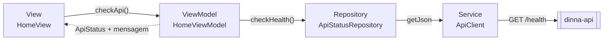

# Arquitetura MVVM

Contrato das camadas do app Dinna. O fluxo de referência é a verificação da API na home (`GET /health`). Não há UseCase, service locator nem biblioteca de injeção de dependência.

A composição fica em [`lib/main.dart`](../lib/main.dart): `AppConfig` → `ApiClient` → `HttpApiStatusRepository` → `DinnaApp`. O router só repassa o repository. O `HomeViewModel` nasce no `State` da `HomeView` e é descartado no `dispose`.

## Responsabilidades

| Camada | Faz | Não faz |
|---|---|---|
| **View** (`HomeView`) | Desenha o estado e encaminha o toque do usuário. Observa o ViewModel com `ListenableBuilder`. | Chamar HTTP, decidir regra de negócio ou traduzir erro. |
| **ViewModel** (`HomeViewModel`) | Guarda o estado de apresentação (`unknown`, `checking`, `online`, `offline`) e a mensagem. Executa a ação, impede verificação duplicada e chama `notifyListeners()`. | Conhecer widget, `BuildContext`, `http`, `ApiClient` ou `ApiException`. |
| **Repository** (`ApiStatusRepository`, implementação `HttpApiStatusRepository`) | Entregar dados ao ViewModel. Traduzir o JSON de `/health` e a `ApiException` para `ApiAvailability`. | Conhecer widget, estado visual ou montar URL e status code. |
| **Service** (`ApiClient`) | Falar com a API: URL base, timeout, serialização e status HTTP. Converter falha de rede, timeout, status não-2xx e corpo que não é JSON em `ApiException`. | Guardar estado de tela ou conhecer uma feature. |

`ApiClient` é o Service. Não existe outra classe só para repetir essa função.

## Dependências permitidas

O dado segue uma direção: View → ViewModel → Repository → Service → API. A seta de volta para a View é só notificação de estado.

| Quem | Pode depender de | Não depende de |
|---|---|---|
| View | ViewModel e widgets Flutter | Repository, `ApiClient`, `package:http` |
| ViewModel | Contrato do Repository e `ChangeNotifier` | `material.dart`, `ApiClient`, `ApiException`, `package:http` |
| Repository concreto | `ApiClient` e `ApiException` | View, ViewModel, widgets |
| `ApiClient` | `package:http` e `ApiException` | `lib/features/`, widgets, ViewModels |

O contrato `ApiStatusRepository` não importa o Service. Quem implementa (`HttpApiStatusRepository`) é montado no `main`. Testes substituem o contrato por um fake; não há singleton global.

## Fluxo de referência: `GET /health`

1. A home abre com `ApiStatus.unknown` e o texto "API não verificada".
2. O usuário toca em "Verificar conexão com a API".
3. A View chama `HomeViewModel.checkApi`. O botão fica desabilitado enquanto o estado é `checking`.
4. O ViewModel grava `checking`, limpa a mensagem e notifica a View ("Verificando…").
5. O ViewModel chama `ApiStatusRepository.checkHealth`.
6. `HttpApiStatusRepository` chama `ApiClient.getJson('/health')`.
7. O `ApiClient` faz `GET {API_BASE_URL}/health`.
8. O resultado volta pelas camadas:
   - `{ "status": "ok" }` vira `ApiAvailability.online`. O ViewModel vai para `online` e a View mostra "API online".
   - JSON diferente vira `ApiAvailability.offline('Resposta inesperada da API')`. A View mostra "API indisponível" e a mensagem.
   - Rede, timeout, status fora de 2xx ou corpo que não é JSON viram `ApiException` no Service. O Repository converte em `ApiAvailability.offline` com `error.message`. O ViewModel não vê status code.
9. O ViewModel publica o estado e notifica de novo. Se a tela já foi descartada, não altera o estado nem notifica.
10. Uma falha que o repository não traduziu tira o ViewModel de `checking` e o leva a `offline`, com a mensagem "Não foi possível verificar a API". O texto da exceção não entra na tela.

## Como adicionar uma feature

1. Criar `lib/features/<feature>/` com View, ViewModel e o contrato do Repository.
2. A implementação que chama a API fica em outra classe e usa `ApiClient.getJson` (ou o método HTTP que o Service passar a expor). Ela traduz `ApiException` antes de devolver o resultado ao ViewModel.
3. O ViewModel recebe o contrato pelo construtor, expõe loading, success e error, e depois do `dispose` não altera estado nem chama `notifyListeners`. Uma exceção que o repository não traduziu vira erro de tela genérico, para a UI não permanecer em loading.
4. A View cria o ViewModel no `State`, observa com `ListenableBuilder` e descarta no `dispose`.
5. Montar a implementação concreta em `lib/main.dart` e passar o contrato pelo construtor até a tela. Registrar a rota em `app_router.dart` só quando a navegação dessa feature entrar no escopo.
6. Não adicionar `provider`, `get_it`, UseCase ou outra camada sem uma necessidade que este fluxo não cubra.

Models compartilhados (SCRUM-22) e persistência local (SCRUM-27) ainda não existem. Quando a persistência entrar, ela será outra fonte atrás de um Repository, não um atalho da View para o disco.

## Como testar

Os testes de unidade não chamam a API real.

| Alvo | Como | O que travar |
|---|---|---|
| ViewModel | Fake que implementa `ApiStatusRepository` e devolve um `Completer`, um `ApiAvailability` ou uma exceção | `checking` antes da resposta, success, error, exceção inesperada e a ausência de atualização depois do `dispose` |
| Repository | `HttpApiStatusRepository` com `ApiClient` e `MockClient` | `{ "status": "ok" }`, JSON inesperado, erro de rede e status HTTP inválido |
| Service | `ApiClient` com `MockClient` | URL, corpo de erro da API, falha de rede e corpo que não é JSON |

O fake do fluxo de referência está em [`test/features/home/fake_api_status_repository.dart`](../test/features/home/fake_api_status_repository.dart).
