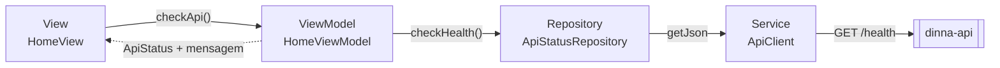
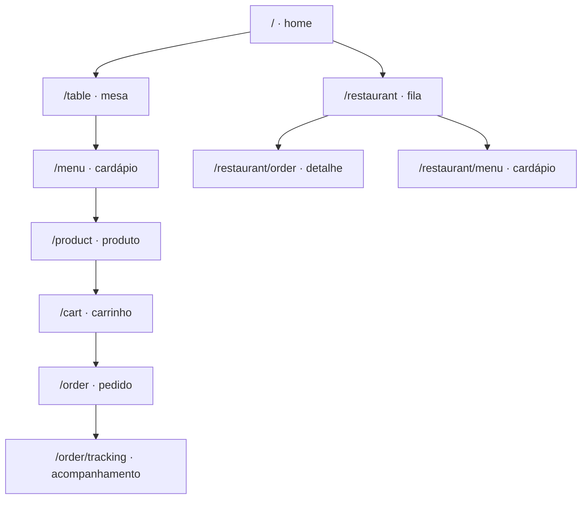

# Arquitetura MVVM

Contrato das camadas do app Dinna. O fluxo de referência é a verificação da API na home (`GET /health`). Não há UseCase, service locator nem biblioteca de injeção de dependência.

A composição fica em [`lib/main.dart`](../lib/main.dart): `AppConfig` → `ApiClient` → `HttpApiStatusRepository` → `DinnaApp`. O router só repassa o repository. O `HomeViewModel` nasce no `State` da `HomeView` e é descartado no `dispose`.

O mapa de rotas, o nome desconhecido e a integração com a tela de mesa estão em [Navegação](#navegação).

## Responsabilidades

| Camada | Faz | Não faz |
|---|---|---|
| **View** (`HomeView`) | Desenha o estado e encaminha o toque do usuário. Observa o ViewModel com `ListenableBuilder`. | Chamar HTTP, decidir regra de negócio ou traduzir erro. |
| **ViewModel** (`HomeViewModel`) | Guarda o estado de apresentação (`unknown`, `checking`, `online`, `offline`) e a mensagem. Executa a ação, impede verificação duplicada e chama `notifyListeners()`. | Conhecer widget, `BuildContext`, `http`, `ApiClient` ou `ApiException`. |
| **Repository** (`ApiStatusRepository`, implementação `HttpApiStatusRepository`) | Entregar dados ao ViewModel. Traduzir o JSON de `/health` e a `ApiException` para `ApiAvailability`. | Conhecer widget, estado visual ou montar URL e status code. |
| **Service** (`ApiClient`) | Falar com a API: URL base, timeout, serialização e status HTTP. Converter falha de rede, timeout, status não-2xx e corpo que não é JSON em `ApiException`. | Guardar estado de tela ou conhecer uma feature. |

`ApiClient` é o Service. Não existe outra classe só para repetir essa função.

## Dependências permitidas

O dado segue uma direção: View → ViewModel → Repository → Service → API. A seta de volta para a View é só notificação de estado.

| Quem | Pode depender de | Não depende de |
|---|---|---|
| View | ViewModel e widgets Flutter | Repository, `ApiClient`, `package:http` |
| ViewModel | Contrato do Repository e `ChangeNotifier` | `material.dart`, `ApiClient`, `ApiException`, `package:http` |
| Repository concreto | `ApiClient` e `ApiException` | View, ViewModel, widgets |
| `ApiClient` | `package:http` e `ApiException` | `lib/features/`, widgets, ViewModels |
| Model (`lib/core/domain/`) | `dart:core` e outros models do domínio | Widget, View, ViewModel, Repository, `ApiClient`, `package:http` |

O contrato `ApiStatusRepository` não importa o Service. Quem implementa (`HttpApiStatusRepository`) é montado no `main`. Testes substituem o contrato por um fake; não há singleton global.

## Fluxo de referência: `GET /health`

1. A home abre com `ApiStatus.unknown` e o texto "API não verificada".
2. O usuário toca em "Verificar conexão com a API".
3. A View chama `HomeViewModel.checkApi`. O botão fica desabilitado enquanto o estado é `checking`.
4. O ViewModel grava `checking`, limpa a mensagem e notifica a View ("Verificando…").
5. O ViewModel chama `ApiStatusRepository.checkHealth`.
6. `HttpApiStatusRepository` chama `ApiClient.getJson('/health')`.
7. O `ApiClient` faz `GET {API_BASE_URL}/health`. Se `API_TOKEN` estiver preenchido, a chamada também leva `X-Dinna-Api-Token`. O servidor deixa `/health` público; o header não altera o contrato dessa rota.
8. O resultado volta pelas camadas:
   - `{ "status": "ok" }` vira `ApiAvailability.online`. O ViewModel vai para `online` e a View mostra "API online".
   - JSON diferente vira `ApiAvailability.offline('Resposta inesperada da API')`. A View mostra "API indisponível" e a mensagem.
   - Rede, timeout, status fora de 2xx ou corpo que não é JSON viram `ApiException` no Service. O Repository converte em `ApiAvailability.offline` com `error.message`. O ViewModel não vê status code.
9. O ViewModel publica o estado e notifica de novo. Se a tela já foi descartada, não altera o estado nem notifica.
10. Uma falha que o repository não traduziu tira o ViewModel de `checking` e o leva a `offline`, com a mensagem "Não foi possível verificar a API". O texto da exceção não entra na tela. Em debug, o console do Flutter mostra a falha para diagnóstico; em release, esse registro não acontece.

## Token de acesso do ambiente

`API_TOKEN` é lido em [`app_config.dart`](../lib/core/config/app_config.dart) com `String.fromEnvironment`. Vazio ou ausente significa a API local sem proteção. Preenchido, o [`ApiClient`](../lib/core/network/api_client.dart) envia `X-Dinna-Api-Token` em todos os métodos que já existem (`getJson` e `postJson`). Não há PUT, PATCH nem DELETE nesse client. O header não substitui `Content-Type`, `Idempotency-Key` nem outro header entregue pelo repositório.

HTTP 401 com `error.code` `UNAUTHORIZED` segue o caminho já usado para falha de servidor: vira `ApiException` e `DataFailure.unavailable`, não `notFound`. A mensagem da API pode chegar à tela. O token não entra nessa mensagem, em log nem na interface. O client não repete a chamada. No envio do pedido, a `Idempotency-Key` continua na intenção; 401 não apaga essa intenção, o carrinho nem as preferências da recomendação.

`--dart-define` grava o valor no binário. Isso é aceitável só em builds controlados da equipe, até a apresentação. Não é armazenamento seguro, não deve ir para loja e o token deve ser rotacionado depois. A URL pública do Railway ainda não entra nesta documentação: use o placeholder `https://<url-publica-do-railway>` até o deploy ser confirmado.

## Navegação

O app usa um único `Navigator`, o do `MaterialApp`. [`lib/app/app.dart`](../lib/app/app.dart) define `initialRoute: AppRoutes.home` (`/`) e `onGenerateRoute`. O mapa fica em [`lib/app/router/app_router.dart`](../lib/app/router/app_router.dart). A SCRUM-23 está concluída e mergeada pelo PR #6: manteve o `onGenerateRoute` nativo. Os nomes da R1 ficam em `AppRoutes.clientFlow` e `AppRoutes.restaurantFlow`. O `switch` abre `HomeView`, `TableView`, `MenuView`, `CartView`, a confirmação, o acompanhamento, a fila e o detalhe do pedido. `/product` e `/restaurant/menu` caem no `RoutePlaceholder`. A dependência continua entrando pelo construtor.

### Responsabilidades

| Peça | Faz | Não faz |
|---|---|---|
| `AppRoutes` | Guarda os nomes estáveis e a ordem de cada fluxo. | Construir widget, ler argumento ou escolher a rota inicial. |
| `AppRouter` | Escolhe a página em `onGenerateRoute` e repassa o `RouteSettings`. Entrega o `ApiStatusRepository` à home pelo construtor do `HomeViewModel`. | Chamar HTTP, autenticar, persistir ou desenhar tela de produto. |
| `RoutePlaceholder` | Ocupa a rota cuja View ainda não existe, para o teste conseguir entrar, seguir e voltar. | Substituir a tela da story. |
| `UnknownRouteView` | Responde a qualquer nome fora do mapa com o texto "Página não encontrada". | Lançar exceção ou redirecionar para a home. |
| `DinnaApp` | Liga a rota inicial, o tema e o repository ao router. | Escolher a página. |

`onGenerateRoute` sempre devolve um `MaterialPageRoute`. O nome desconhecido é o ramo final do `switch`, então `onUnknownRoute` fica sem uso. O `AppRouter` nasce no `build` do `DinnaApp` e recebe `apiStatusRepository` pelo construtor. A home é a única rota com dependência injetada. As demais não recebem repository.

### Mapa

Os nomes são correspondência exata: sem barra no fim e sem parâmetro no caminho. O id de um detalhe viaja em `RouteSettings.arguments` como `AppRouteId`.

| Fluxo | Constante | Nome | Argumento | Tela na `dev` |
|---|---|---|---|---|
| Fundação | `home` | `/` | — | `HomeView`, com `GET /health`, o último pedido e as entradas "Sou cliente" (`/table`) e "Restaurante" (`/restaurant`). Rota inicial |
| Cliente | `table` | `/table` | — | `TableView`. Valida a mesa e abre `/menu` com ela (SCRUM-29) |
| Cliente | `menu` | `/menu` | mesa (`String`) | `MenuView`. Produtos por categoria, via `MenuViewModel` (SCRUM-30) |
| Cliente | `product` | `/product` | `AppRouteId` | Placeholder. O detalhe abre como bottom sheet a partir do cardápio (SCRUM-36), sem trocar de rota |
| Cliente | `cart` | `/cart` | mesa (`String`) | `CartView`. Revisão no processo, via `CartLines`. |
| Cliente | `order` | `/order` | `OrderConfirmationArgs` | `OrderConfirmationView`. Pedido já gravado, sem outro POST |
| Cliente | `orderTracking` | `/order/tracking` | `AppRouteId` | `OrderTrackingView`. Identifica o pedido e não atualiza o status |
| Restaurante | `restaurant` | `/restaurant` | — | `OrdersQueueView`. Fila de pedidos |
| Restaurante | `restaurantOrder` | `/restaurant/order` | `RestaurantOrderArgs` | `OrderDetailsView`. Exige o id e o pedido já carregado. Só `AppRouteId` mostra "Pedido indisponível" |
| Restaurante | `restaurantMenu` | `/restaurant/menu` | — | Placeholder |

`AppRoutes.clientFlow` e `AppRoutes.restaurantFlow` registram essa ordem. A ordem é a jornada da R1, não uma pilha obrigatória: qualquer nome do mapa abre com `Navigator.pushNamed`.

A home de fundação permanece em `/` e não ganha botão de produto. `/table` desenha a `TableView`, `/menu` a `MenuView`, `/cart` a `CartView`, `/order` a confirmação, `/order/tracking` o acompanhamento, `/restaurant` a fila e `/restaurant/order` o detalhe. `/product` e `/restaurant/menu` desenham `RoutePlaceholder`. Quem entra nos fluxos é o teste, por `pushNamed`. O retorno é `Navigator.pop`. O placeholder usa `AppBar`, então o botão de voltar desempilha a rota. A `TableView` não tem `AppBar`. O `AppBar` da `MenuView` não mostra seta, como no Figma: volta-se pelo botão do sistema.

### Argumentos

`AppRouteId` carrega o id do produto ou do acompanhamento. O router não lê nem valida o argumento: o `MaterialPageRoute` recebe o `RouteSettings` inteiro. A View da story lê `ModalRoute.of(context)!.settings.arguments`. As rotas de detalhe são `product`, `orderTracking` e `restaurantOrder` (`AppRoutes.detailRoutes`). Em `/restaurant/order`, o argumento é `RestaurantOrderArgs`: o id e o pedido que a fila já carregou. Sem esse pedido, a tela mostra "Pedido indisponível" e não consulta a API.

### TableView (PR #3)

O PR [#3](https://github.com/jeancarlosaps/dinna-flutter/pull/3) está mergeado na `dev`, no commit `79b8156`. A SCRUM-23 está concluída e mergeada pelo PR [#6](https://github.com/jeancarlosaps/dinna-flutter/pull/6), no commit `b7b32d1`.

[`lib/app/app.dart`](../lib/app/app.dart) mantém `initialRoute: AppRoutes.home`. A entrada da fundação continua `/`, com a home e o `GET /health`. [`test/app_test.dart`](../test/app_test.dart) cobre essa rota inicial. A abertura do app em `/table` não foi adotada. Se a rota inicial passar a ser `/table`, os testes que esperam a home em `/` precisam ser adaptados.

O `switch` de [`app_router.dart`](../lib/app/router/app_router.dart) devolve `const TableView()` em `AppRoutes.table`, antes do ramo de placeholder. O nome `/table` permanece em `AppRoutes.clientFlow`. `AppRoutes.menu` devolve a `MenuView` com o `MenuViewModel` e a mesa lida de `settings.arguments`. `/cart`, `/order`, `/order/tracking`, `/restaurant` e `/restaurant/order` também têm tela própria. `/product` e `/restaurant/menu` continuam em `RoutePlaceholder`.

A `TableView` fica em [`lib/features/client/table/table_view.dart`](../lib/features/client/table/table_view.dart). O layout mostra a marca, o texto “Qual é a sua mesa?”, um campo numérico e o botão “Ver cardápio”. O `TableViewModel` nasce no `State` e valida o texto: vazio, zero ou não numérico deixa `errorMessage`, mostrado no `errorText` do campo. Mesa válida volta normalizada (`" 012 "` vira `"12"`) e a tela chama `Navigator.pushNamed(AppRoutes.menu, arguments: mesa)`, com a mesa como `String`. A tela pertence à jornada do cliente e não leva ao painel: a entrada do restaurante fica na Home. A tela não tem `AppBar`.

A `MenuView` fica em [`lib/features/menu/menu_view.dart`](../lib/features/menu/menu_view.dart). O `MenuViewModel` nasce no `State`, chama `ProductRepository.list` e expõe `loading`, `ready` e `failed`. A tela mostra uma seção por categoria, na ordem da API, e os chips filtram uma categoria (nula é “Todos”). A busca (SCRUM-33) filtra pelo nome o cardápio já carregado, sem nova chamada à API: `MenuViewModel.search` guarda o texto e `groupedMatches` devolve só as categorias com resultado, sem diferenciar maiúsculas nem acentos. `groupedProducts` continua completo, porque a barra do carrinho usa os preços de todos os produtos. Produto com `available == false` aparece em cinza com o selo “Esgotado”. A mesa recebida aparece no header e segue para o carrinho por `onOpenCart`, que o router liga a `AppRoutes.cart`.

O detalhe do produto fica em [`lib/features/menu/product_detail_view.dart`](../lib/features/menu/product_detail_view.dart). Tocar um card chama `showProductDetail`, que abre um bottom sheet sobre o cardápio, como no Figma. O `ProductDetailViewModel` nasce no `State` do sheet com o id tocado; o router entrega a fábrica à `MenuView` por `createDetailViewModel`. A mesa não sai do cardápio. A foto e o degradê vêm de `ProductImage`, compartilhado com o card. A caixa “Ingredientes” junta `product.ingredients` por vírgula, na ordem da API; lista vazia mantém a caixa e orienta a consultar o restaurante. A quantidade (SCRUM-37) é estado local do `State` do sheet, de 1 a `ProductDetailView.maxQuantity` (99), e não passa pelo ViewModel. O botão mostra `priceCents * quantidade` como estimativa; o total do pedido continua vindo da API. `onAdd` recebe o produto e a quantidade; nulo, o botão fica desabilitado.

O remoto `feature/client-ui` foi removido depois do merge. O case de `/table` e o restante do mapa da SCRUM-23 convivem na `dev`.

O mesmo PR versionou dois PDFs dentro de `lib/`: `Dinna · App Cliente Marina.pdf` (5,5 MB) e `Dinna · App Restaurante Ricardo.pdf` (8,6 MB). Eles não estão no `pubspec` como asset e não participam do código da feature. Ficam no clone, ao lado dos fontes, e aumentam o repositório. A retirada fica para outro PR.

### Troca do placeholder pela View

`/table` já tem case próprio. Nas rotas que ainda usam `RoutePlaceholder`, a story ganha um case no `switch`, antes do ramo do placeholder. O nome em `AppRoutes` permanece na lista do fluxo. Dependência nova segue o caminho da home: `main` → `DinnaApp` → `AppRouter` → construtor da View ou do ViewModel. A View da feature continua criando o ViewModel no `State`.

## Como adicionar uma feature

1. Criar `lib/features/<feature>/` com View, ViewModel e o contrato do Repository.
2. A implementação que chama a API fica em outra classe e usa `ApiClient.getJson` (ou o método HTTP que o Service passar a expor). Ela traduz `ApiException` antes de devolver o resultado ao ViewModel.
3. O ViewModel recebe o contrato pelo construtor, expõe loading, success e error, e depois do `dispose` não altera estado nem chama `notifyListeners`. Uma exceção que o repository não traduziu vira erro de tela genérico, para a UI não permanecer em loading.
4. A View cria o ViewModel no `State`, observa com `ListenableBuilder` e descarta no `dispose`.
5. Montar a implementação concreta em `lib/main.dart` e passar o contrato pelo construtor até o `AppRouter`. No `onGenerateRoute`, a rota ganha um case próprio antes do `RoutePlaceholder`. O nome já está em `AppRoutes`; a story não cria um nome paralelo.
6. Não adicionar `provider`, `get_it`, UseCase ou outra camada sem uma necessidade que este fluxo não cubra.

A SCRUM-18 segue em andamento. O HTTP está configurado: `package:http` 1.6.0 e `ApiClient` integrado em [`lib/main.dart`](../lib/main.dart). A SCRUM-70 persiste as linhas do carrinho em SQLite via `CartRepository` em [`lib/features/client/cart/`](../lib/features/client/cart/). A `CartSession` conecta a persistência à inclusão e à revisão: `main` a injeta, `DinnaApp` inicia `restore()` na abertura e o primeiro `CartViewModel` só nasce depois da restauração. Ao abrir o carrinho, o ViewModel consulta o catálogo atual para apresentar itens indisponíveis ou ausentes. `ProcessCartLines` permanece no fluxo compatível em memória e nos testes. A SCRUM-90 grava a intenção do `POST /orders` num arquivo, usando `path_provider` para localizar o diretório. A SCRUM-72 persiste o último pedido confirmado na tabela `last_orders` do banco SQLite versionado compartilhado com o carrinho e o apresenta na home após restaurar a sessão. A versão 2 acrescenta `cart_reconciliations` e a versão 3 acrescenta `last_orders`. Um banco na versão 1 recebe as duas tabelas; um banco que já está na versão 2 conserva o carrinho e a conciliação. As persistências atendem a fluxos distintos; a View não acessa diretamente o disco. Preferências locais seguem fora desses escopos.

## Models de domínio

Os models compartilhados ficam em [`lib/core/domain/`](../lib/core/domain/). São imutáveis, não chamam HTTP e não conhecem ViewModel. O Repository traduz o JSON da API; o carrinho e a preferência nascem no app.

**Models REST**, alinhados a `docs/api-contract.md` da dinna-api: `Product`, `OrderItem`, `Order` e `OrderStatus`.

**Models locais**, sem recurso nem endpoint novo: `CartItem` e `Preference`.

`CartItem` guarda `productId`, `quantity`, `note` opcional e o `lineId` local opcional, atribuído ao persistir uma inclusão. O `lineId` distingue linhas mesmo quando produto e observação coincidem e nunca é enviado à API. Antes de `POST /orders`, `CartItem.toOrderItem()` produz o `OrderItem` do contrato. O carrinho não copia nome, preço ou imagem e não calcula `totalCents`.

`Preference` guarda o texto livre do cliente em `{ "text": "..." }`. Não é um recurso REST, e esse JSON não é o body de `POST /ai/recommendation`. O texto preenchido alimenta o campo opcional `preferences` desse endpoint (R2). Texto vazio não envia o campo.

`fromJson` rejeita campo obrigatório ausente e tipo incompatível. Dinheiro do contrato fica em centavos inteiros (`priceCents`, `totalCents`). `createdAt` só entra com sufixo `Z` maiúsculo, como em `"2026-10-16T18:00:00Z"`.

## Como testar

Os testes de unidade não chamam a API real.

| Alvo | Como | O que travar |
|---|---|---|
| ViewModel | Fake que implementa `ApiStatusRepository` e devolve um `Completer`, um `ApiAvailability` ou uma exceção | `checking` antes da resposta, success, error, exceção inesperada e a ausência de atualização depois do `dispose` |
| Repository | `HttpApiStatusRepository` com `ApiClient` e `MockClient` | `{ "status": "ok" }`, JSON inesperado, erro de rede e status HTTP inválido |
| Service | `ApiClient` com `MockClient` | URL, corpo de erro da API, falha de rede e corpo que não é JSON |
| Model | `fromJson` e `toJson` | obrigatório ausente, tipo incompatível, `CartItem` → `OrderItem`, preferência vazia, status desconhecido e centavos não inteiros |
| Router | `DinnaApp` com o fake de `ApiStatusRepository` | rota inicial `/`, `/table` com `TableView`, placeholder nas outras rotas, ida e volta, nome desconhecido, `AppRouteId` preservado, home e `GET /health` depois do retorno |

O fake do fluxo de referência está em [`test/features/home/fake_api_status_repository.dart`](../test/features/home/fake_api_status_repository.dart).
