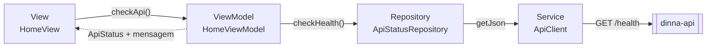
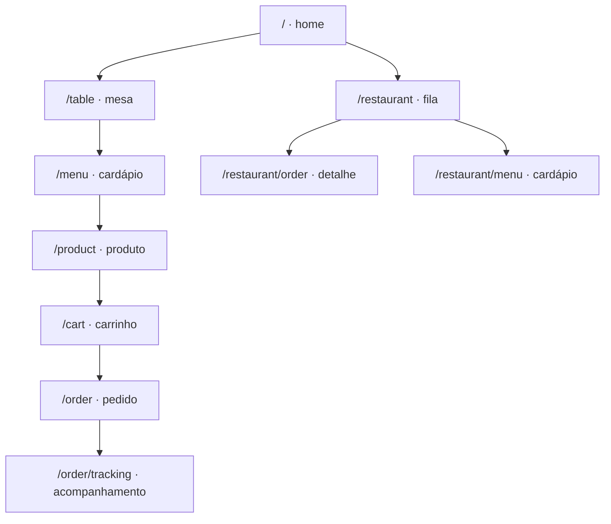

# Arquitetura MVVM

Contrato das camadas do app Dinna. O fluxo de referência é a verificação da API na home (`GET /health`). Não há UseCase, service locator nem biblioteca de injeção de dependência.

A composição fica em [`lib/main.dart`](../lib/main.dart): `AppConfig` → `ApiClient` → `HttpApiStatusRepository` → `DinnaApp`. O router só repassa o repository. O `HomeViewModel` nasce no `State` da `HomeView` e é descartado no `dispose`.

O mapa de rotas, o nome desconhecido e a integração com a tela de mesa estão em [Navegação](#navegação).

## Responsabilidades

| Camada | Faz | Não faz |
|---|---|---|
| **View** (`HomeView`) | Desenha o estado e encaminha o toque do usuário. Observa o ViewModel com `ListenableBuilder`. | Chamar HTTP, decidir regra de negócio ou traduzir erro. |
| **ViewModel** (`HomeViewModel`) | Guarda o estado de apresentação (`unknown`, `checking`, `online`, `offline`) e a mensagem. Executa a ação, impede verificação duplicada e chama `notifyListeners()`. | Conhecer widget, `BuildContext`, `http`, `ApiClient` ou `ApiException`. |
| **Repository** (`ApiStatusRepository`, implementação `HttpApiStatusRepository`) | Entregar dados ao ViewModel. Traduzir o JSON de `/health` e a `ApiException` para `ApiAvailability`. | Conhecer widget, estado visual ou montar URL e status code. |
| **Service** (`ApiClient`) | Falar com a API: URL base, timeout, serialização e status HTTP. Converter falha de rede, timeout, status não-2xx e corpo que não é JSON em `ApiException`. | Guardar estado de tela ou conhecer uma feature. |

`ApiClient` é o Service. Não existe outra classe só para repetir essa função.

## Dependências permitidas

O dado segue uma direção: View → ViewModel → Repository → Service → API. A seta de volta para a View é só notificação de estado.

| Quem | Pode depender de | Não depende de |
|---|---|---|
| View | ViewModel e widgets Flutter | Repository, `ApiClient`, `package:http` |
| ViewModel | Contrato do Repository e `ChangeNotifier` | `material.dart`, `ApiClient`, `ApiException`, `package:http` |
| Repository concreto | `ApiClient` e `ApiException` | View, ViewModel, widgets |
| `ApiClient` | `package:http` e `ApiException` | `lib/features/`, widgets, ViewModels |
| Model (`lib/core/domain/`) | `dart:core` e outros models do domínio | Widget, View, ViewModel, Repository, `ApiClient`, `package:http` |

O contrato `ApiStatusRepository` não importa o Service. Quem implementa (`HttpApiStatusRepository`) é montado no `main`. Testes substituem o contrato por um fake; não há singleton global.

## Fluxo de referência: `GET /health`

1. A home abre com `ApiStatus.unknown` e o texto "API não verificada".
2. O usuário toca em "Verificar conexão com a API".
3. A View chama `HomeViewModel.checkApi`. O botão fica desabilitado enquanto o estado é `checking`.
4. O ViewModel grava `checking`, limpa a mensagem e notifica a View ("Verificando…").
5. O ViewModel chama `ApiStatusRepository.checkHealth`.
6. `HttpApiStatusRepository` chama `ApiClient.getJson('/health')`.
7. O `ApiClient` faz `GET {API_BASE_URL}/health`.
8. O resultado volta pelas camadas:
   - `{ "status": "ok" }` vira `ApiAvailability.online`. O ViewModel vai para `online` e a View mostra "API online".
   - JSON diferente vira `ApiAvailability.offline('Resposta inesperada da API')`. A View mostra "API indisponível" e a mensagem.
   - Rede, timeout, status fora de 2xx ou corpo que não é JSON viram `ApiException` no Service. O Repository converte em `ApiAvailability.offline` com `error.message`. O ViewModel não vê status code.
9. O ViewModel publica o estado e notifica de novo. Se a tela já foi descartada, não altera o estado nem notifica.
10. Uma falha que o repository não traduziu tira o ViewModel de `checking` e o leva a `offline`, com a mensagem "Não foi possível verificar a API". O texto da exceção não entra na tela. Em debug, o console do Flutter mostra a falha para diagnóstico; em release, esse registro não acontece.

## Navegação

O app usa um único `Navigator`, o do `MaterialApp`. [`lib/app/app.dart`](../lib/app/app.dart) define `initialRoute: AppRoutes.home` e `onGenerateRoute`. O mapa fica em [`lib/app/router/app_router.dart`](../lib/app/router/app_router.dart). A SCRUM-23 mantém o `onGenerateRoute` nativo. Os nomes da R1 ficam em `AppRoutes.clientFlow` e `AppRoutes.restaurantFlow`; o `switch` escolhe a página a partir dessas listas. A dependência continua entrando pelo construtor.

### Responsabilidades

| Peça | Faz | Não faz |
|---|---|---|
| `AppRoutes` | Guarda os nomes estáveis e a ordem de cada fluxo. | Construir widget, ler argumento ou escolher a rota inicial. |
| `AppRouter` | Escolhe a página em `onGenerateRoute` e repassa o `RouteSettings`. Entrega o `ApiStatusRepository` à home pelo construtor do `HomeViewModel`. | Chamar HTTP, autenticar, persistir ou desenhar tela de produto. |
| `RoutePlaceholder` | Ocupa a rota cuja View ainda não existe, para o teste conseguir entrar, seguir e voltar. | Substituir a tela da story. |
| `UnknownRouteView` | Responde a qualquer nome fora do mapa com o texto "Página não encontrada". | Lançar exceção ou redirecionar para a home. |
| `DinnaApp` | Liga a rota inicial, o tema e o repository ao router. | Escolher a página. |

`onGenerateRoute` sempre devolve um `MaterialPageRoute`. O nome desconhecido é o ramo final do `switch`, então `onUnknownRoute` fica sem uso. O `AppRouter` nasce no `build` do `DinnaApp` e recebe `apiStatusRepository` pelo construtor. A home é a única rota desta task com dependência. As demais não recebem repository.

### Mapa

Os nomes são correspondência exata: sem barra no fim e sem parâmetro no caminho. O id de um detalhe viaja em `RouteSettings.arguments` como `AppRouteId`.

| Fluxo | Constante | Nome | Argumento | Tela nesta task |
|---|---|---|---|---|
| Fundação | `home` | `/` | — | `HomeView`, com `GET /health` |
| Cliente | `table` | `/table` | — | Placeholder. A `TableView` de `feature/client-ui` ocupa este nome na integração |
| Cliente | `menu` | `/menu` | — | Placeholder |
| Cliente | `product` | `/product` | `AppRouteId` | Placeholder |
| Cliente | `cart` | `/cart` | — | Placeholder |
| Cliente | `order` | `/order` | — | Placeholder |
| Cliente | `orderTracking` | `/order/tracking` | `AppRouteId` | Placeholder |
| Restaurante | `restaurant` | `/restaurant` | — | Placeholder. Entrada do painel, na fila de pedidos |
| Restaurante | `restaurantOrder` | `/restaurant/order` | `AppRouteId` | Placeholder |
| Restaurante | `restaurantMenu` | `/restaurant/menu` | — | Placeholder |

`AppRoutes.clientFlow` e `AppRoutes.restaurantFlow` registram essa ordem. A ordem é a jornada da R1, não uma pilha obrigatória: qualquer nome do mapa abre com `Navigator.pushNamed`.

A home de fundação permanece como está e não ganha botão de produto. Quem entra nos fluxos nesta task é o teste, por `pushNamed`. O retorno é `Navigator.pop`. O placeholder usa `AppBar`, então o botão de voltar desempilha a mesma rota.

### Argumentos

`AppRouteId` carrega o id do produto ou do pedido. O router não lê nem valida o argumento: o `MaterialPageRoute` recebe o `RouteSettings` inteiro. A View da story lê `ModalRoute.of(context)!.settings.arguments`. As rotas de detalhe são `product`, `orderTracking` e `restaurantOrder` (`AppRoutes.detailRoutes`).

### Integração com a UI do Gabriel

O PR [#3](https://github.com/jeancarlosaps/dinna-flutter/pull/3) (`feature/client-ui`, rascunho, base `dev`) já definiu a entrada do cliente:

- a constante `AppRoutes.table`;
- o nome `/table`;
- a `TableView` em `lib/features/client/table/table_view.dart`;
- `initialRoute` apontando para `AppRoutes.table`.

Esta branch adota o nome e a constante. A `TableView` continua só no PR dele. O placeholder de `/table` existe para o teste de roteamento. No merge, `/table` ganha um case próprio antes do ramo do placeholder, devolvendo `const TableView()`. O nome permanece em `AppRoutes.table` e em `clientFlow`.

`lib/app/app.dart` não muda aqui. A rota inicial segue `AppRoutes.home`, a home e o `GET /health` continuam no lugar, e [`test/app_test.dart`](../test/app_test.dart) segue válido. A troca de `initialRoute` para `/table` permanece no PR #3. Na hora de integrar, essa linha fica em aberto: `/` enquanto a home de fundação for a entrada, ou `/table` quando a mesa for a entrada de produto. O restante do mapa entra nos dois desfechos.

Os botões da `TableView` ainda não navegam (`onPressed` vazio). Quando a tela for ligada ao mapa:

- "Ver cardápio" chama `Navigator.pushNamed(context, AppRoutes.menu)`;
- "Acessar o painel" chama `Navigator.pushNamed(context, AppRoutes.restaurant)`.

A branch `feature/client-ui` divergiu em `b6b132c`. Desde esse commit, `app_router.dart` e `app.dart` não mudaram na `dev`. O conflito previsto no merge é o `switch` de `app_router.dart`, porque os dois PRs declaram `AppRoutes.table`. A resolução fica com a `TableView` no case `/table` e com as outras rotas deste mapa. Os PDFs que o PR #3 versiona em `lib/` ficam fora desta branch.

### Troca do placeholder pela View

Quando a story da tela entrar, a rota ganha um case próprio no `switch`, antes do ramo que devolve `RoutePlaceholder`. O nome em `AppRoutes` permanece na lista do fluxo. Dependência nova segue o caminho da home: `main` → `DinnaApp` → `AppRouter` → construtor da View ou do ViewModel. A View da feature continua criando o ViewModel no `State`.

## Como adicionar uma feature

1. Criar `lib/features/<feature>/` com View, ViewModel e o contrato do Repository.
2. A implementação que chama a API fica em outra classe e usa `ApiClient.getJson` (ou o método HTTP que o Service passar a expor). Ela traduz `ApiException` antes de devolver o resultado ao ViewModel.
3. O ViewModel recebe o contrato pelo construtor, expõe loading, success e error, e depois do `dispose` não altera estado nem chama `notifyListeners`. Uma exceção que o repository não traduziu vira erro de tela genérico, para a UI não permanecer em loading.
4. A View cria o ViewModel no `State`, observa com `ListenableBuilder` e descarta no `dispose`.
5. Montar a implementação concreta em `lib/main.dart` e passar o contrato pelo construtor até o `AppRouter`. No `onGenerateRoute`, a rota ganha um case próprio antes do `RoutePlaceholder`. O nome já está em `AppRoutes`; a story não cria um nome paralelo.
6. Não adicionar `provider`, `get_it`, UseCase ou outra camada sem uma necessidade que este fluxo não cubra.

A persistência local (SCRUM-27) ainda não existe. Quando entrar, será outra fonte atrás de um Repository, não um atalho da View para o disco.

## Models de domínio

Os models compartilhados ficam em [`lib/core/domain/`](../lib/core/domain/). São imutáveis, não chamam HTTP e não conhecem ViewModel. O Repository traduz o JSON da API; o carrinho e a preferência nascem no app.

**Models REST**, alinhados a `docs/api-contract.md` da dinna-api: `Product`, `OrderItem`, `Order` e `OrderStatus`.

**Models locais**, sem recurso nem endpoint novo: `CartItem` e `Preference`.

`CartItem` guarda `productId`, `quantity` e `note` opcional. Antes de `POST /orders`, `CartItem.toOrderItem()` produz o `OrderItem` do contrato. O carrinho não copia nome, preço ou imagem e não calcula `totalCents`.

`Preference` guarda o texto livre do cliente em `{ "text": "..." }`. Não é um recurso REST, e esse JSON não é o body de `POST /ai/recommendation`. O texto preenchido alimenta o campo opcional `preferences` desse endpoint (R2). Texto vazio não envia o campo.

`fromJson` rejeita campo obrigatório ausente e tipo incompatível. Dinheiro do contrato fica em centavos inteiros (`priceCents`, `totalCents`). `createdAt` só entra com sufixo `Z` maiúsculo, como em `"2026-10-16T18:00:00Z"`.

## Como testar

Os testes de unidade não chamam a API real.

| Alvo | Como | O que travar |
|---|---|---|
| ViewModel | Fake que implementa `ApiStatusRepository` e devolve um `Completer`, um `ApiAvailability` ou uma exceção | `checking` antes da resposta, success, error, exceção inesperada e a ausência de atualização depois do `dispose` |
| Repository | `HttpApiStatusRepository` com `ApiClient` e `MockClient` | `{ "status": "ok" }`, JSON inesperado, erro de rede e status HTTP inválido |
| Service | `ApiClient` com `MockClient` | URL, corpo de erro da API, falha de rede e corpo que não é JSON |
| Model | `fromJson` e `toJson` | obrigatório ausente, tipo incompatível, `CartItem` → `OrderItem`, preferência vazia, status desconhecido e centavos não inteiros |
| Router | `DinnaApp` com o fake de `ApiStatusRepository` | rota inicial `/`, entrada em `/table` e `/restaurant`, ida e volta, nome desconhecido, `AppRouteId` preservado, home e `GET /health` depois do retorno |

O fake do fluxo de referência está em [`test/features/home/fake_api_status_repository.dart`](../test/features/home/fake_api_status_repository.dart).
